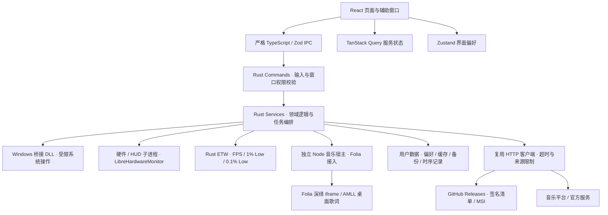

<div align="center">

<picture>
  <source media="(prefers-color-scheme: dark)" srcset="public/assets/home/brand-light.png" />
  
</picture>

# 臻境 · Zhenjing

**把游戏、音乐与桌面工具，留在一个顺手的地方。**

面向 Windows 的游戏与桌面工具箱 · React / TypeScript / Rust / Tauri 2

[](LICENSE)
[](https://github.com/surgar04/m78deguren/releases)
[](https://github.com/surgar04/m78deguren/releases/latest)
[](https://github.com/surgar04/m78deguren/actions/workflows/check.yml)

[下载安装](https://github.com/surgar04/m78deguren/releases/latest) · [更新日志](CHANGELOG.md) · [问题反馈](https://github.com/surgar04/m78deguren/issues) · [第三方说明](THIRD_PARTY_NOTICES.md)

</div>

---

## 可以做什么

| 页面 / 入口        | 主要能力                                                                                                                                               |
| ------------------ | ------------------------------------------------------------------------------------------------------------------------------------------------------ |
| **首页**           | 系统或自定义用户名问候、公告与一言、随机图片、硬件摘要、EXE 快捷启动、图标提取与拖动排序、游戏模式和 Win 键控制                                        |
| **游戏库**         | Steam 安装与运行检测、库目录和容量、已安装与账号库存游戏、搜索和启动、商店与安装目录、Steam 安装 / 卸载流程、本机账号管理；识别其他游戏及国服 / 国际服 |
| **硬件**           | CPU、GPU、内存、主板、BIOS、磁盘与外设信息；实时传感器；ETW 帧率统计；复制信息、导出带图表和时间筛选的 HTML 报告                                       |
| **工具箱**         | 准心、屏幕测试、录屏管理、下载、网络测速、时间同步、运行库检查与修复，以及按权限开放的 Windows 工具                                                    |
| **系统优化**       | 分类扫描真实配置、风险和修改预览、单项 / 批量操作、备份与恢复；以编译期白名单限制系统修改范围                                                          |
| **音乐**           | QQ 音乐、网易云音乐、YouTube Music、Spotify 与本地音乐；封面和歌词匹配、歌单与搜索、桌面歌词；手动开启全屏沉浸演绎和 17 种歌词样式                     |
| **HUD / 轮盘**     | 统一桌面 HUD，展示系统、媒体、下载和游戏性能；八向快捷轮盘支持可配置按键、位置、大小及透明度                                                           |
| **设置与首次启动** | 主题、字体、图片 / 视频背景、热键、网络诊断、缓存与存储、更新；独立首次启动向导按步骤准备环境                                                          |

所有页面以原生服务的真实数据为准。未安装、无权限、接口不可用或设备不支持时，显示实际空状态与错误，不生成模拟读数。

> 音乐播放受账号权益、地区、平台接口及网络限制。QuickFox 协作功能依赖用户自行安装的官方客户端，不包含节点、账号或付费服务。游戏画面、第三方服务与商标归各自权利人所有。

## 安装与更新

1. 在 [Releases](https://github.com/surgar04/m78deguren/releases) 下载 `zhenjing-<版本>-windows-x64.msi`。
2. 按安装向导选择应用与数据目录。面向用户的版本不依赖开发机的 D 盘路径。
3. 首次启动按向导完成准备。分区、迁移、驱动与系统工具只在明确确认后执行。

**运行要求：** Windows 10 / 11 x64、Microsoft Edge WebView2。安装包包含独立音乐宿主、应用私有运行库和自包含 .NET 组件；用户不需要 Node.js、Rust、pnpm、Visual Studio 或 .NET SDK。

应用更新仅接受固定仓库的 **Ed25519 签名清单**，下载后验证 MSI 长度与 SHA256，再在游戏和关键任务空闲时安装。失败记录用于阻止同包循环重装。

- MSI 当前使用 **Sur方糖自签名证书**，并非公共 CA 认证；Windows 可能显示未知发布者提示。本项目不自动导入证书信任。
- 各版本附 `SHA256SUMS.txt`、`build-info.json` 和 `INSTALL.md`；源码与构建锁文件随对应 Git 标签公开。
- 安装问题见 [安装故障排查](docs/INSTALLATION-TROUBLESHOOTING.md)。

## 架构



前端统一经 `src/lib/desktop.ts` 访问原生接口；Rust 再次验证输入、窗口来源、路径和操作白名单。辅助进程使用独立协议、超时、组件摘要和生命周期管理，不向前端开放任意命令执行。

```text
src/
  app/                  路由与应用入口
  pages/                页面边界
  features/             领域界面、查询、交互与样式
  lib/                  IPC、严格协议与公共能力
src-tauri/
  src/commands/         原生命令与权限校验
  src/services/         Windows、硬件、游戏、音乐及更新服务
  capabilities/         Tauri 最小权限声明
  resources/            可校验原生组件、来源清单及许可
native/                 C# / C++ 组件与独立音乐宿主
integrations/           冻结的 Folia 来源与演绎适配
scripts/                环境、构建、签名、发布及验收
docs/                   实现说明、设计资料与维护文档
```

## 本地开发

开发入口统一配置隔离工具链和写入目录。**本机开发约定要求位于 `D:\新境`，新建文件、依赖、缓存与产物均写入 D 盘；该约束不作为用户安装条件。** 具体规则见 [AGENTS.md](AGENTS.md)。

工具链版本以 `package.json`、`rust-toolchain.toml`、`pnpm-lock.yaml` 和 `src-tauri/Cargo.lock` 为准。新环境先按 [开发环境说明](docs/development/开发环境与构建.md) 准备便携工具，不使用全局安装命令替代项目入口。

```powershell
# 检查环境
powershell -NoProfile -ExecutionPolicy Bypass -File .\dev.ps1 env:check

# 启动真实桌面开发预览
powershell -NoProfile -ExecutionPolicy Bypass -File .\dev.ps1 desktop:dev

# 完整质量检查；不执行真实系统安装、分区或账号切换
powershell -NoProfile -ExecutionPolicy Bypass -File .\dev.ps1 check

# 构建发布版 MSI；构建与上传是两个独立步骤
powershell -NoProfile -ExecutionPolicy Bypass -File .\dev.ps1 desktop:build
```

检查涵盖格式、ESLint、严格类型、前端与原生协议测试、Rust fmt / Clippy / 测试、安装权限与分发组件。桌面发布另需实际 Release 链接、MSI 解包及独立目录启动验收；静态检查不等同于真实账号、驱动或干净系统安装验证。

## 分支与发行

- `main`：经过审核、检查与合并的稳定源码；不直接提交日常开发代码。
- `codex/develop`：开发集成分支；功能分支按 `codex/feat-<主题>`、`codex/fix-<主题>` 或 `codex/docs-<主题>` 命名，通过 PR 合入。
- 提交使用 Conventional Commits，例如 `feat(music): ...`、`fix(installer): ...`、`docs(readme): ...`。
- 稳定版与开发者版采用独立发布资产和更新清单；开发者版标为预发布，不替换稳定版的 `latest`。认证、回退和运维约定见 [开发者版本与认证](docs/development/开发者版本与认证.md)。
- 发布版可在关于页选择更新到开发者版本；认证后可选源码目录，获取开发分支并准备隔离开发环境。缺少 C++ / SDK 时提供微软官方入口，流程见 [开发者工作区](docs/development/开发者工作区与版本切换.md)。

README、许可及首次公开内容须先交由维护者审核，再推送和发布。后续操作流程见 [CONTRIBUTING.md](CONTRIBUTING.md) 和 [MSI 发布与签名](docs/development/MSI发布与签名.md)。

## 开源项目与致谢

| 项目                                                                                                                                                  | 本项目的使用方式                                                     | 上游许可                            |
| ----------------------------------------------------------------------------------------------------------------------------------------------------- | -------------------------------------------------------------------- | ----------------------------------- |
| [NexBox](https://github.com/MuLiuSaMa/NexBox)                                                                                                         | 功能、页面逻辑与优化配置事实参考；领域服务和界面重写，未打包上游应用 | GPL-3.0；其部分组件另有许可         |
| [Folia](https://github.com/chthollyphile/folia-major)                                                                                                 | 音乐平台适配、歌词演绎与背景的冻结来源，外围实现原生宿主和传输适配   | AGPL-3.0                            |
| [Apple Music-like Lyrics](https://github.com/amll-dev/applemusic-like-lyrics)                                                                         | 普通播放器的独立桌面歌词渲染                                         | AGPL-3.0-only                       |
| [Endfield Charge Plus](https://github.com/GlacierGlimmer/zmd-charge-plus)                                                                             | HUD 引擎、视觉模板和动画来源，适配本项目数据与窗口体系               | MIT                                 |
| [LibreHardwareMonitor](https://github.com/LibreHardwareMonitor/LibreHardwareMonitor)                                                                  | 真实硬件传感器，由受控子进程桥接                                     | MPL-2.0                             |
| [PresentMon](https://github.com/GameTechDev/PresentMon) / ECPFrames                                                                                   | 显示器 / 指定窗口帧率路径；游戏帧率另由 Rust ETW 实现                | MIT，保留组件原文                   |
| [Tauri](https://github.com/tauri-apps/tauri)、[React](https://github.com/facebook/react)、[Tailwind CSS](https://github.com/tailwindlabs/tailwindcss) | 桌面、界面和样式基础                                                 | MIT / Apache-2.0 或 MIT，以各包为准 |

另外使用 TanStack Query、Zustand、Zod、GSAP、Font Awesome、Inter、MiSans，以及 .NET / Node.js 运行库。**并非所有资产和 SDK 都使用相同开源协议**；GSAP、字体、图标和微软运行库须遵守各自条款，不由根目录协议重新许可。

固定提交、修改边界、其他依赖、许可原文和字体来源集中记录在 [THIRD_PARTY_NOTICES.md](THIRD_PARTY_NOTICES.md)。外部驱动及安装器按需从官方来源获取，不因列在致谢中即表示随包分发。

## 许可证与安全边界

本项目代码按 **[GNU Affero General Public License v3.0 only](LICENSE)** 分发，与已集成的 Folia / AMLL 许可保持兼容。分发修改版时保留版权和许可、提供对应完整源码与构建所需材料；第三方代码和资源保留其原许可。详见 [许可选择说明](docs/LICENSING.md)。

开发者身份仅控制**官方开发者发行渠道和应用内开发模式**，不额外限制 AGPL 赋予的查看、修改与再分发权利，也不将客户端认证描述为绝对防破解。

请勿在 Issue、日志或 PR 中上传 Cookie、平台登录凭据、stoken、签名私钥及用户档案。安全问题与处理边界见 [SECURITY.md](SECURITY.md)。

---

<div align="center">由 Sur方糖维护 · 为日常游戏与桌面体验而作</div>
