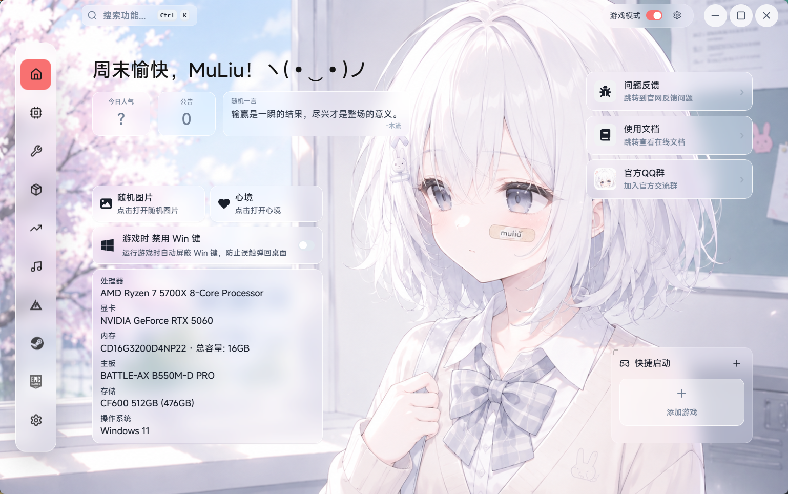
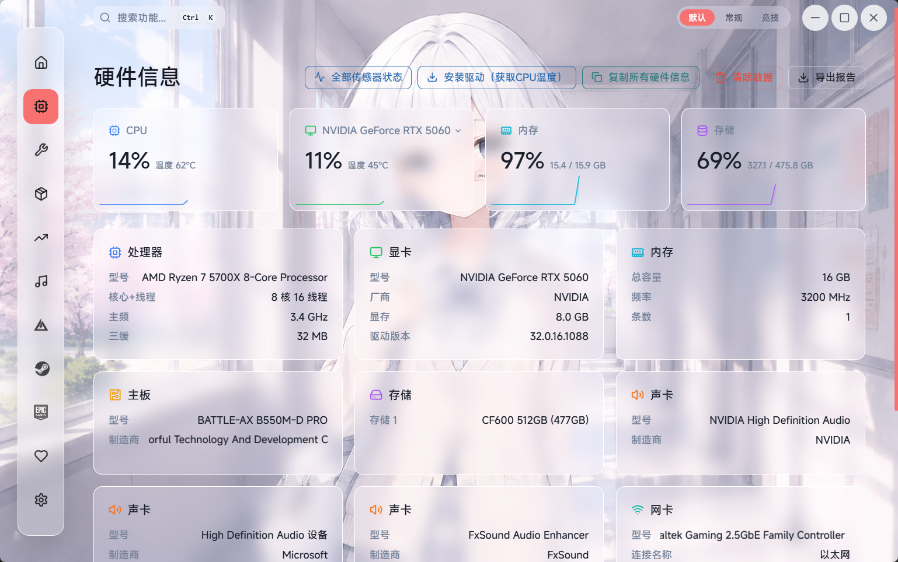
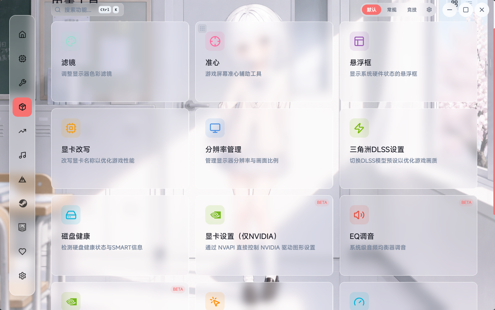
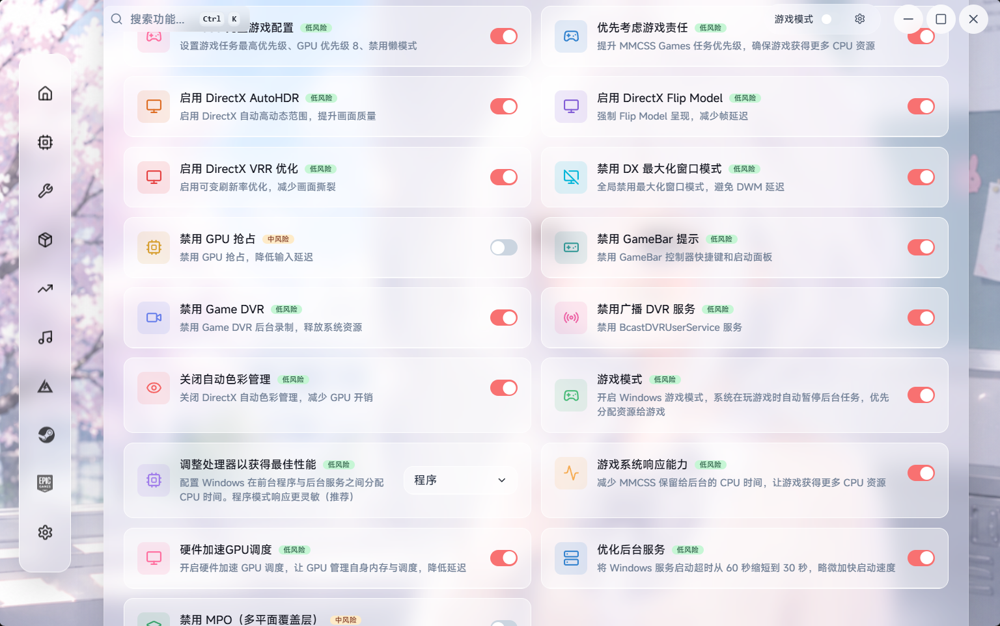
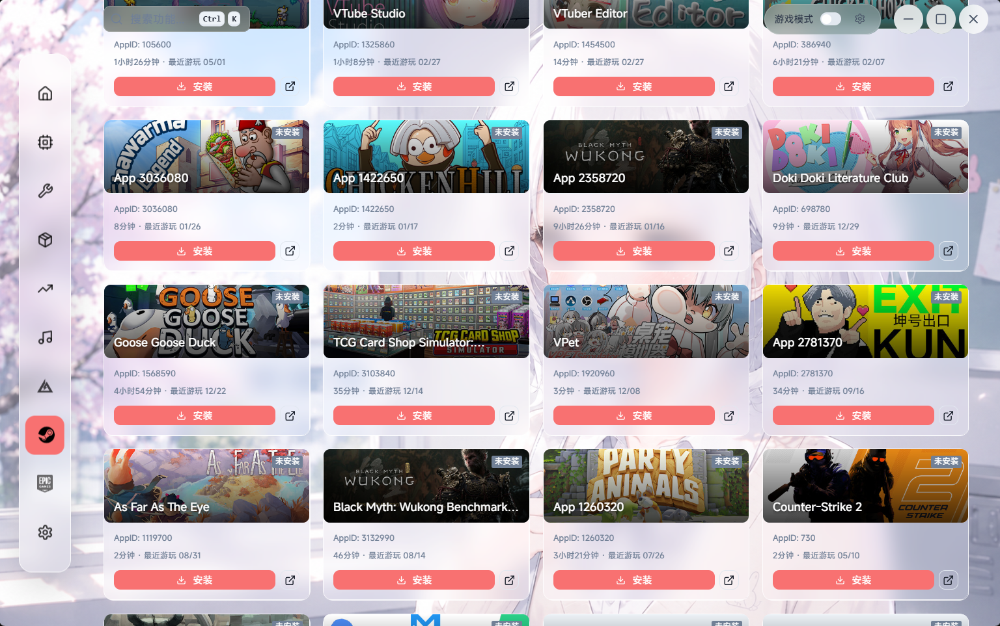
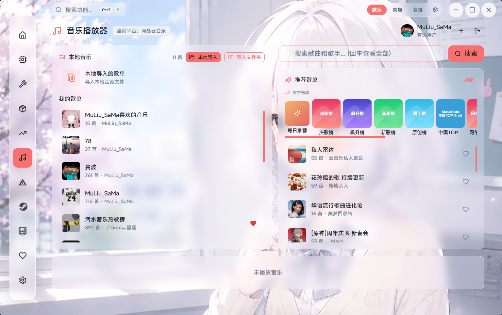
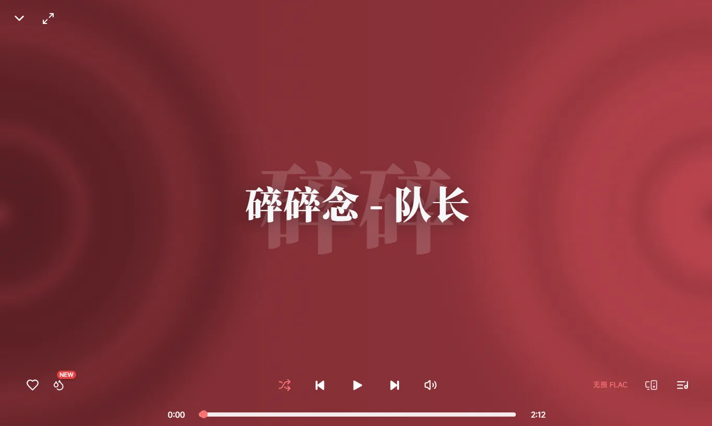
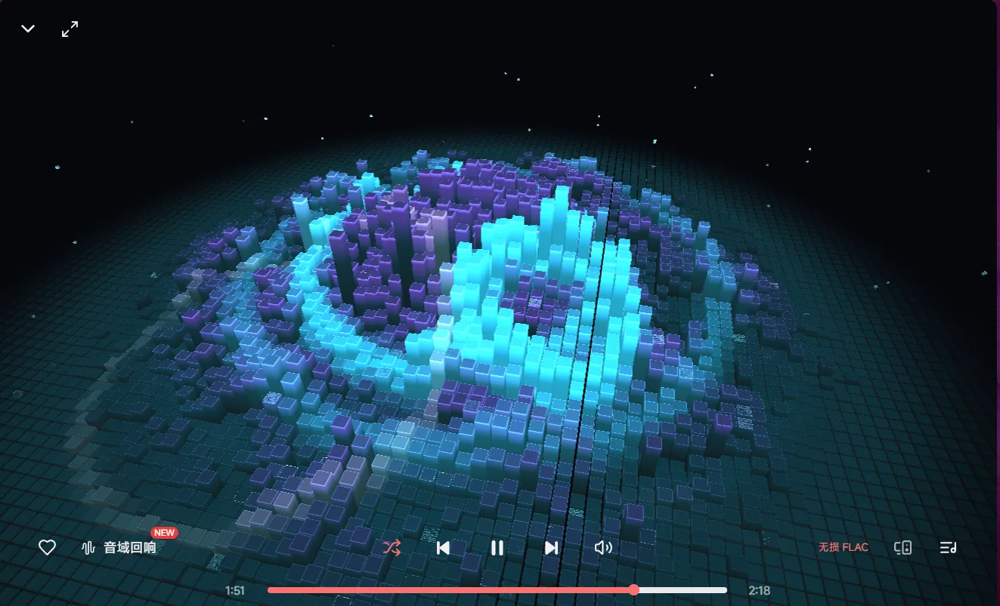

# NexBox UI 风格深度分析

> 分析日期：2026-10-24  
> 项目：[MuLiuSaMa/NexBox](https://github.com/MuLiuSaMa/NexBox)  
> 源码版本：10.2.1，提交 `e7ad6a0bb9197e206bb9a719ca86c6353a5cad43`  
> 分析方式：Product Design 视觉分析框架，结合仓库官方截图与主题、布局、组件、动效源码交叉核对。  
> 配套资料：[UI 参数与源码索引](./NexBox-UI设计参数与源码索引.md)、[既有功能分析](./NexBox-功能全景与实现分析.md)。

## 阅读导航

- [1. 风格结论](#1-风格结论)
- [2. 证据与分析边界](#2-证据与分析边界)
- [3. 设计系统的三个层次](#3-设计系统的三个层次)
- [4. 应用外壳与空间组织](#4-应用外壳与空间组织)
- [5. 配色：把默认值、截图值与语义色分开](#5-配色把默认值截图值与语义色分开)
- [6. 材质：普通卡片、磨砂和折射的区别](#6-材质普通卡片磨砂和折射的区别)
- [7. 字体、字阶与信息层级](#7-字体字阶与信息层级)
- [8. 图标、形状与组件语法](#8-图标形状与组件语法)
- [9. 六类页面的逐页视觉分析](#9-六类页面的逐页视觉分析)
- [10. 音乐展开态：产品内部的第二套视觉场景](#10-音乐展开态产品内部的第二套视觉场景)
- [11. 动效：柔和、弹性与可触感](#11-动效柔和弹性与可触感)
- [12. 灵动岛与桌面浮层的视觉角色](#12-灵动岛与桌面浮层的视觉角色)
- [13. 布局密度与滚动](#13-布局密度与滚动)
- [14. 主题和背景适配的真实能力](#14-主题和背景适配的真实能力)
- [15. 可读性与无障碍风险](#15-可读性与无障碍风险)
- [16. Android 的风格：同源概念，不同配色与实现](#16-android-的风格同源概念不同配色与实现)
- [17. 风格优势与主要取舍](#17-风格优势与主要取舍)
- [18. 改进优先级](#18-改进优先级)
- [19. 可提炼的 UI 设计规范](#19-可提炼的-ui-设计规范)
- [20. 尚需补充的验证](#20-尚需补充的验证)
- [21. 来源](#21-来源)

## 1. 风格结论

NexBox 的主要设计语言可以概括为：**以个性化壁纸为舞台，用浮动导航、圆角卡片、半透明玻璃表面和柔和动效承载游戏工具；同时保留面向硬件、参数与系统维护的信息结构。**

它有三个相互叠加的部分：

1. **工具台骨架**：全局搜索、常驻导航、模块入口、指标卡、参数列表和开关，保证复杂功能可以被组织和访问。
2. **桌面美化表层**：壁纸/视频、玻璃、主题色、字体和布局偏好，使软件具有个人桌面的感觉。
3. **娱乐与情绪表达**：问候语、颜文字、二次元插画、音乐封面、彩胶和频谱等，降低传统系统工具的生硬感。

官方截图中最醒目的“浅色插画壁纸 + 珊瑚红强调 + 毛玻璃”，只是这套系统的一种配置。**当前源码的默认主题主色是薄荷绿 `#98DDD0`，不是截图中的红色。** 关闭玻璃、切换主题或换背景后，产品观感会明显改变。[U05] [U06] [U07]

### 1.1 风格关键词与证据

| 风格特征     | 截图/源码体现                                  | 对产品感受的影响                           |
| ------------ | ---------------------------------------------- | ------------------------------------------ |
| 个性化桌面感 | 全屏壁纸、角落分布卡片、用户问候               | 更像个人工具桌面，弱化后台管理系统的距离感 |
| 轻盈与通透   | 淡色半透明面、细亮边、背景透出                 | 控件看起来浮在壁纸上，而不是铺满不透明面板 |
| 柔和几何     | 卡片圆角、胶囊、圆形窗口按钮                   | 与偏硬核的系统功能形成温和反差             |
| 模块化       | 图标块 + 标题 + 简介、同尺寸网格               | 方便扩充大量工具，也容易产生“工具货架”观感 |
| 多色识别     | 功能图标与硬件指标分配独立色彩                 | 帮助快速扫视，不完全依赖统一品牌色         |
| 触感动效     | 活动底块移动、按压倾斜、弹性排序、可选果冻动画 | 强化可操作感，但需要控制频率和运动幅度     |
| 娱乐界面分化 | 音乐展开态可进入封面、彩胶、沉浸、频谱等样式   | 从效率工具切换到内容体验，风格允许较大变化 |

### 1.2 视觉类比的边界

浮动 Dock、胶囊和液态玻璃让它接近 Apple 系桌面/移动界面的部分视觉语汇；磨砂和半透明表面又与 Windows Acrylic 一类材质有相似之处。这些是视觉类比，不表示项目使用苹果官方组件、WinUI 或完整遵循 Fluent 设计系统。

实际桌面 UI 以 Chakra UI、React、CSS、Framer Motion 与自定义组件构建。它也不宜被概括成“工业科技风”：核心视觉较柔和、生活化，硬件属性主要由内容、图标和参数表达。

## 2. 证据与分析边界

### 2.1 本次使用的视觉材料

| 编号 | 仓库材料         | 本次用途                       | 原图尺寸   |
| ---- | ---------------- | ------------------------------ | ---------- |
| V01  | 首页官方预览     | 整体构图、留白、导航、壁纸关系 | 1538 × 964 |
| V02  | 硬件官方预览     | 指标层级、色彩编码、详情卡     | 1538 × 964 |
| V03  | 工具官方预览     | 入口网格、图标块、BETA、密度   | 1536 × 964 |
| V04  | 系统优化官方预览 | 双列设置项、开关、风险徽标     | 1536 × 963 |
| V05  | Steam 官方预览   | 封面网格、统一操作区、信息截断 | 1536 × 963 |
| V06  | 音乐官方预览     | 双区浏览、搜索、收藏和播放区   | 1536 × 964 |

另查看了仓库内六种音乐风格的预览素材，文档补充展示其中不含大段歌词的沉浸态与频谱态。原图随文档保存在 `assets/nexbox-ui/`；尺寸、来源和文件校验值见 [证据清单](./assets/nexbox-ui/evidence.json)。

### 2.2 这些材料不能证明什么

本次没有启动桌面程序或 Android APK。浏览器画面读取未能稳定完成，因此**这是一份官方视觉材料与源码研究，不是完整运行时 UX/无障碍审计**。没有实测鼠标悬停、键盘、屏幕阅读器、缩放、动画流畅度或不同背景下的实时可读性。

仓库随附截图也不保证与同一提交的页面实现完全同步。例如 V01 的右上角是三张横向信息卡，而当前 `HomePage`/`QqFeedbackCards` 已将反馈、文档、QQ群入口组织成一排 80px 方形卡。这是材料不同步，不能据此断言当前程序渲染错误。[U22] [U29]

V03、V04、V05 包含滚动到中段的画面；它们适合分析卡片样式，不足以评判页首标题是否缺失。以下结论按三种证据表述：

- **截图可见**：只描述原图中实际出现的内容。
- **源码确认**：参数、条件分支和交互机制确实存在，但运行效果未实测。
- **设计判断**：基于前两类证据提出的解释或改进方向，不冒充用户研究结果。

## 3. 设计系统的三个层次

NexBox 并不是只靠某一张壁纸形成风格。其设计系统由稳定骨架、可配置外观和内容专用样式组成。

| 层次     | 相对稳定的规则                                   | 会改变的内容                                        |
| -------- | ------------------------------------------------ | --------------------------------------------------- |
| 应用骨架 | 主内容区、全局搜索、标题栏、模块导航、卡片与表单 | 导航可放左侧或顶部，顺序和文字可调整                |
| 外观偏好 | 圆角、层次和交互反馈的基本语法                   | 深浅主题、主色、字体、壁纸、视频、MR、玻璃模式      |
| 内容专用 | 每个领域的任务结构                               | 硬件用指标/参数，Steam 用封面，音乐可进入沉浸式样式 |

这个区分决定了复用方式：如果只复制“插画 + 模糊”，会失去导航、密度、信息层级等关键规则；如果只复制卡片网格，又会失去其桌面美化与情绪表达。[U02] [U03] [U25]

## 4. 应用外壳与空间组织

### 4.1 从系统窗口到应用自己的视觉外壳

Tauri 主窗口默认尺寸为 1230 × 771，最小 1140 × 715，关闭原生装饰。顶部 48px 标题区域和右侧 36 × 36px 的圆形窗口按钮由应用绘制，给出比标准 Windows 标题栏更轻、更圆的观感。[U01] [U04]

官方截图约为上述窗口尺寸的 1.25 倍，但没有运行环境证据确认它来自系统缩放、导出还是其他处理。**截图像素不能直接当作 CSS 尺寸。** 例如图中的导航按钮约 60 像素，而源码明确是 48 CSS px。

### 4.2 浮动侧栏，而非贴边菜单

侧栏不是占据整条窗口边缘的实心栏，而是与边缘留有距离、垂直居中的圆角容器。当前源码有：

- 侧边模式 `maxWidth: 64px`，`top: 50%`，用位移垂直居中。
- 导航单元 48 × 48px，普通线性图标 20px、描边 2.2。
- 活动项由独立底块在导航项之间移动，形成连续的选中反馈。
- 可配置文字显示、顺序、显隐，且可切换顶部布局。

这种处理强化了“漂浮在桌面上的 Dock”感，也把背景完整地保留下来。代价是纯图标状态需要用户记住含义；截图是无文字配置，但当前源码默认文字开关为开启，不能写成“整个产品固定只提供图标导航”。[U03]

### 4.3 全局搜索承担第二条访问路径

左上角搜索框带放大镜和 `Ctrl K` 提示，把大量模块从层级菜单转换为可直接搜索的目的地。视觉上它是浅色、小体量的浮动输入区，不与主页面标题争夺面积。

它对工具数量增长很有价值；但搜索不能补偿所有入口的命名问题。搜索词、模块标题、导航名称和工具卡标题需要一致，才能形成清楚的定位感。[U30]

### 4.4 主内容区的固定留白

侧栏模式主区左边距 96px、顶部内边距 56px；顶部导航模式顶部空间增加为 120px。内容区独立滚动，保持标题栏和导航常驻。[U02]

由此形成“固定外壳 + 滚动内容”的桌面软件结构。它适合宽屏工具台，但最小窗口宽度和固定像素定位说明：存在响应式网格，不等于整个桌面应用已经适配手机窄屏。

## 5. 配色：把默认值、截图值与语义色分开

### 5.1 三种不同的颜色来源

| 来源                     | 确认值/表现                 | 应如何理解                                                 |
| ------------------------ | --------------------------- | ---------------------------------------------------------- |
| 动态主题主色             | 默认 `#98DDD0`              | 控制活动项、主按钮、滚动指示等，可由用户替换               |
| 官方截图强调色           | 实色区域采样为 `#F87171`    | 这组截图的珊瑚红配置，不是源码默认色                       |
| `theme.ts` 的 brand 色阶 | 例如 brand.500 为 `#6366F1` | 基础主题中仍有靛蓝色槽，不能据此断定实际 UI 全站以靛蓝为主 |

主题色还派生 hover、active 和 border 的透明度，默认分别为 0.2、0.3、0.4。主色在配置层集中，但页面仍存在硬编码颜色和专用语义色，属于“集中主题与局部样式并存”。[U05] [U06]

### 5.2 中性色承担可读性

普通表面的浅色卡片以白色为主，深色卡片常见 `#111111`，边界常见 `gray.200` / `#333333`；主框架背景是 `#FAFAFA` / `#0A0A0A`，基础主题 body 还保留另外的底色值。

这意味着“背景色”不只有一项 token：最终观感由当前背景模式、组件覆盖和透明层合成。把基础 theme 的 body 值直接当成所有页面实际背景，会丢失重要上下文。[U02] [U05] [U10]

### 5.3 多色功能分类

图标和指标使用多种色相：蓝、绿、青、紫、橙、粉等。图标通常放在同色低透明度小底块上，形成“色彩贴纸”的识别方式。

V02 中 CPU、GPU、内存、存储各有自己的图标和折线颜色；V03 的工具图标也按条目配置颜色。这有助于扫视，但目前不是严格统一的跨平台语义映射——Android 的 GPU/内存/存储颜色分配与桌面截图存在差别。[U21] [U36] [U37] [U32]

### 5.4 状态色与主题色的冲突

截图中红色既用于“已开启”和普通主操作，也接近删除/警告按钮的暖色。红色主题本身不是错误，但若成功、选中、危险都依赖接近的颜色，用户就需要更多文字和形状来判断操作含义。

设计上应把“用户选择的装饰主色”与“危险、警告、成功”分开管理；特别是系统优化，不能只靠一个颜色相近的小开关传达风险。

## 6. 材质：普通卡片、磨砂和折射的区别

### 6.1 普通卡片

玻璃关闭时，卡片使用不透明背景、细边框和圆角。主要靠留白、边线和局部层次区分内容。它更适合阅读参数、密集列表和系统维护，不要求背景图片足够“配合”。[U10] [U15]

### 6.2 普通玻璃

共享卡片的普通玻璃分支包含：

- 浅色 `rgba(255,255,255,0.25)`，深色 `rgba(0,0,0,0.25)`。
- 不同透明度的白色细边线。
- `blur(...)` 与部分组件中的饱和度提升。
- 高光边缘叠层和约 0.45s 的材质过渡。

它的关键是让背景参与表面颜色。V01—V06 的卡片随背后图像产生粉、蓝、灰的微妙变化，视觉统一性不仅来自一组固定 HEX，还来自共同背景。[U10] [U11]

### 6.3 “real” 液态玻璃

项目确实存在 SVG 位移贴图与 `feDisplacementMap` 分支，并非所有“液态玻璃”都只是名称。卡片对窄边缘单独处理，尽量保持正文区域清晰；全局滤镜强度为 1，灵动岛专用为 30，二者强度不同。

但 `real` 是项目自己的模式命名，不代表物理精确的玻璃模拟，也不等于官方平台材质。支持检测包含浏览器判断与 CSS 属性检查，不能据此保证所有 WebView/驱动组合效果完全一致。[U12]

### 6.4 三个容易误读的默认状态

1. React 状态初始为无背景，但首次启动加载逻辑会启用预设壁纸 1 和轮播。
2. 普通玻璃状态初始为关闭，模糊值初始为 1；没有证据表明截图中的强磨砂就是这个默认值。
3. 果冻动画也有独立开关，初始为关闭。

所以既不能将宣传图当成开箱默认，也不能只读 `useState("none")` 就断言首次启动没有背景。[U07]

## 7. 字体、字阶与信息层级

### 7.1 默认字体应看运行配置

`theme.ts` 和 CSS 有 Inter 等回退栈，但 `FontProvider` 明确默认 `MiSans`，并通过 CSS 变量应用。内置列表还包括 Sinter、AiDianFengYaHei、Cubic、思源宋体 900，并支持导入字体。

因此应描述为“默认 MiSans、可个性化替换”，不能因为基础 CSS 出现 Inter 就将它认定为主字体。字体变化也会改变中文宽度、卡片换行、长设备名截断和音乐歌词的气质。[U08] [U09]

### 7.2 用大小与重量分离信息

| 文字角色            | 观察与源码规则               | 作用                             |
| ------------------- | ---------------------------- | -------------------------------- |
| 首页问候/核心大数值 | `3xl` + bold                 | 第一眼定位和重点数据             |
| 工具卡标题          | `lg` + bold                  | 清楚表达入口名称                 |
| 硬件详情标题        | `md` + bold                  | 标识每个信息组                   |
| 参数/说明           | `sm`、`xs`                   | 保持密度与主次关系               |
| AppID/次级元信息    | `2xs` 等较小字阶             | 节省空间，但要注意实际可读性     |
| 风险/BETA           | 风险徽标 9px、部分 BETA 10px | 信息量小但语义重要，当前体量偏弱 |

它采用大小、粗细、颜色和位置共同组织信息，而不是复杂的字体家族组合。风险在于“说明越次要越淡、越小”的规则被用于系统操作后，可能使真正关键的限制与风险太不显眼。[U21] [U23] [U15]

### 7.3 数据和长文本的处理

硬件参数通过左右对齐、标签与值分开呈现；长名称使用限制行数、截断或跑马灯类处理。Steam 卡片固定元信息行高度，保持按钮对齐，即使某个游戏缺少游玩数据也留出位置。

这种规则提升网格整齐度，但需要让用户能够获取完整名称。截图中出现设备厂商名称溢长或游戏标题省略，能确认“长内容是现实场景”，不能只用短模拟文案评估布局。[U21] [U24]

## 8. 图标、形状与组件语法

### 8.1 图标体系

桌面主要使用 Lucide/React Icons 一类线性图标，普通导航描边约 2.2，工具网格图标约 28px。系统图标、NVIDIA、Steam、Epic 等品牌标识又包含自定义/图片资源。

形成的规则是：一般功能用轻量线条，品牌入口保留真实标识；彩色底块帮助小图标在复杂背景上站稳。它不是统一 Font Awesome 字体图标系统，若移植到其他工程，应复用功能与层级规则，而不是误认原项目的依赖。[U03] [U15] [U36]

### 8.2 圆角有多个等级

共享卡片常用 `xl`，导航外壳用 `2xl`，主按钮常用 `lg`，状态胶囊和窗口按钮用 full。小图标底块、封面、图片和徽标也各有圆角。

这不是“所有元素同一个圆角”的系统。大容器更柔和，小内容保持辨识，长条状态用胶囊。报告保留原 token，不将它们全部猜测为某个固定像素数。[U03] [U05] [U10]

### 8.3 常见组件公式

| 组件       | 组合方式                                      | 可复用的设计规则               |
| ---------- | --------------------------------------------- | ------------------------------ |
| 工具入口   | 彩色图标块 + 粗体标题 + 次级说明 + 可选 BETA  | 降低模块识别成本，整卡可进入   |
| 优化设置项 | 图标 + 名称 + 风险 + 两行内说明 + 右侧控件    | 将功能和状态放在一行扫描路径中 |
| 硬件指标   | 设备图标/标签 + 大数值 + 单位/温度 + 微型趋势 | 先看现状，再看细节             |
| 游戏卡片   | 宽封面 + 名称/状态 + 元信息 + 固定操作区      | 内容视觉优先，操作位置稳定     |
| 导航项     | 图标/小标签 + 共享移动活动底块                | 让切换有连续性                 |
| 通知       | 顶部胶囊 + 图标/标题 + 可展开进度/详情        | 把反馈集中为统一视觉语言       |

## 9. 六类页面的逐页视觉分析

以下六项是材料阅读顺序，不是本次实际操作完成的连续流程。

### 9.1 V01：首页——壁纸是主角，卡片分布在四周

**视觉状态：空间关系清楚，情绪表达强；首屏任务优先级仍有取舍。**

截图中问候与小卡位于左上，反馈入口在右上，硬件/快捷信息在左下，游戏启动在右下。中间保留大量壁纸，整体更接近“个性化桌面”，而非满屏信息面板。

当前源码的角落锚定也支持这个判断：左下信息块宽 360px，快捷启动靠右下。它有意识地把视觉重心留给背景与问候。但随机图片、心境、硬件、公告、启动器等一起显示时，缺少一个对所有用户都明显的“第一任务”。[U22]

**可借鉴**：用稳定锚点组织个性内容，而不是把每张卡片塞进同一个等高网格。

**需要验证**：更多卡片、较长用户名、字体放大、窗口最小高度时，角落块是否相互覆盖。截图本身不证明这些边界已经处理。

### 9.2 V02：硬件——轻量仪表盘与结构化详情

**视觉状态：层级较成熟；复杂背景与小字存在阅读压力。**

上层四张指标卡用大比例数字建立第一层阅读，下层详情卡按设备组织参数。各硬件类别有自己的色相，且折线与图标一致。微型折线不展示完整坐标系，减少了图表视觉负担，适合快速看趋势。[U21]

顶部还有传感器、驱动、复制、清数据和导出等操作。它们颜色和线框样式不同，但同时横向排列时，主次操作仍比较接近，尤其“清除数据”需要比普通辅助按钮更明确的动作后果。

**可借鉴**：大指标卡与详情卡分层、标签和值对齐、图表简化。

**需要验证**：显卡/磁盘很多时的密度、长厂商名、缺失数据、安装驱动后的反馈与缩放阅读；不能从一张正常态图判断全部状态。

### 9.3 V03：工具——可排序的功能货架

**视觉状态：入口一致、易扩展；大卡片和类似描述增加浏览成本。**

三列等宽卡片，每张卡放彩色图标、标题、简介。48px 图标底块与约 200px 最小卡高使入口有足够可点击空间，但也让工具很多时需要较长滚动。源码提供网格/列表切换和拖动排序，是对效率需求的补充。[U15] [U16] [U17]

BETA 徽标在卡片角落，拖动把手在悬停时出现。默认静态视图干净，但新用户可能不容易发现排序。拖动可用与键盘排序可用是不同命题，当前所读实现以 PointerSensor 为主，键盘流程需要另测。

截图中“显卡改写”配了优化性能类说明，这类文案会影响信任：入口的视觉承诺应该与实际动作一致，不能用“优化”模糊展示名称修改和真实性能调整之间的差别。

### 9.4 V04：系统优化——把高级操作做成设置列表

**视觉状态：结构可扫描；操作风险被柔和外观和小徽标弱化。**

双列设置卡中，左侧图标、名称、简介，右侧开关或选择器，风险徽标紧跟标题。布局对熟悉“系统设置”的用户很直接；但外观上所有条目都像普通偏好设置，高风险操作与主题切换容易拥有相似的交互重量。[U23]

风险不是没有标，而是字号较小、底色较浅、权重偏低。对于可能影响系统状态的条目，更合适的是提供影响范围、是否重启、恢复语义和确认反馈，而不仅是把高风险标红。

**需要验证**：待扫描/未知状态、批量执行中、单项失败、恢复结果和重启提示。目前材料主要展示稳定开关态，不能证明反馈已经完整。

### 9.5 V05：Steam——封面网格承担内容识别

**视觉状态：内容识别快，按钮整齐；重复强调和小字较多。**

相较系统工具，游戏库把封面放到第一位；状态徽标在封面角落，标题压在封面下缘，元信息在下方，主操作保持同一位置。四列让更多游戏同时出现，固定行高使网格稳定。[U24]

大量同色“安装”按钮形成强烈横向节奏，也增加视觉噪声；用户没有聚焦某个游戏时，每个项目都在以同等强度要求行动。AppID、游玩时间等小字可以降权，但核心标题省略时应有完整信息的获取方式。

这里还有可复核的颜色风险：源码中的部分 CTA 固定使用白字，背景却取用户主题色，没有全部复用共享按钮的对比文字逻辑。默认浅薄荷绿对白字的理论对比度仅约 1.55:1，见第 15 章。

### 9.6 V06：音乐——双区浏览与底部播放带

**视觉状态：内容分区明确；多个滚动区域和重复搜索需要协调。**

左边是本地/个人歌单，右边是搜索和推荐内容，下方是常驻播放区。它采用用户熟悉的音乐软件信息结构，封面作为可识别锚点，主题色用于搜索、收藏和滚动指示。

应用全局搜索与音乐搜索同时出现，但服务不同任务：一个找工具，一个找内容。位置、占位文字和视觉体量需要保持区分。内部列表有独立滚动时，卡片边界、空态和滚动提示应共同说明“正在滚动哪一层”。[U25]

截图中未播放状态有底部空态，源码另有加载、失败、评论错误/重试和队列空态。这些是实现存在的证据，尚未现场检查各状态视觉是否一致。

## 10. 音乐展开态：产品内部的第二套视觉场景

音乐不是把普通卡片放大。源码提供六个具名风格：封面渐染、透明彩胶、沉浸、音域回响、现代、通透。[U25]

| 样式     | 视觉中心                 | 与工具页的区别                 |
| -------- | ------------------------ | ------------------------------ |
| 封面渐染 | 大幅封面与取色背景、歌词 | 让内容图像决定画面色彩         |
| 透明彩胶 | 大型唱片物件与留白       | 引入模拟实体媒介的趣味         |
| 沉浸     | 大字与低干扰背景         | 减少工具控件密度，突出当前内容 |
| 音域回响 | 三维频谱场景             | 转向光效、空间与节奏           |
| 现代     | 封面与歌词双区、封面取色 | 布局更有内容播放器的秩序       |
| 通透     | 磨砂背景、封面和歌词     | 延续玻璃材料但提升沉浸度       |

这解释了为何用一句“浅色毛玻璃”无法覆盖整个产品：工具页重在任务扫描，音乐展开态重在内容氛围；同一外壳下可以出现深色霓虹、纯色渐变和大面积留白。

设计判断是保留这种场景分化，但让退出方式、播放控制、快捷键和状态反馈保持可预测。素材展示不等于本次验证了实时频谱、歌词同步或动画帧率。

## 11. 动效：柔和、弹性与可触感

### 11.1 动效系统中的不同职责

| 类型         | 源码参数示例                                | 设计意义                         |
| ------------ | ------------------------------------------- | -------------------------------- |
| 材质切换     | 背景/边框/模糊约 0.45s                      | 主题或玻璃变化不突兀             |
| 背景换图     | 约 0.5s 淡入/淡出                           | 连接不同壁纸，避免硬切           |
| 导航活动底块 | 约 0.45s，带过冲曲线                        | 使目的地切换连续可追踪           |
| 工具排序     | 其他卡片约 380ms 回弹，当前拖动卡即时跟手   | 拖动反馈与周边让位分工           |
| 卡片按压     | 按住约 0.05s，松开约 0.42s 回弹，缩至 0.975 | 用细小形变表现按压               |
| 可选果冻     | 约 0.62s，scale 1.05 → 0.97 → 1.02 等       | 明确的装饰动效，比普通过渡更活跃 |
| 音乐列表     | 子项错开 0.04s、入场约 0.25s                | 强化内容连续出现的节奏           |

这些规则混合 CSS、Framer Motion 和拖动组件，不是 GSAP 实现。参数是源码值，不代表本次测得的体感时长或性能。[U13] [U14] [U15] [U25]

### 11.2 “可触感”应与阅读稳定性平衡

局部按压、拖动让位和导航滑块在操作附近发生，容易解释；整批卡片的果冻动效更偏装饰，持续频繁出现时可能分散阅读。页面切换、图像轮播、玻璃和歌词动画若同时发生，视觉活动会叠加。

源码对 MR 背景识别系统减少动态效果偏好，并有静态回退；但没有在已检查的全局 CSS、果冻和播放器路径发现统一的减少动态效果策略。不能因为一个背景组件做了回退，就推断全产品都满足相关要求。[U27] [U13]

### 11.3 高光与“追光”不要混淆

共享工具卡有 hover 透明度变化、亮边，也会记录鼠标位置。但所检查的 `getBorderGlowStyle` 返回的是统一边缘高光，不是基于指针坐标生成的径向光斑。按压倾斜则确实读取指针位置。二者不能都笼统写成“鼠标追光”。[U18] [U14]

## 12. 灵动岛与桌面浮层的视觉角色

灵动岛把成功、错误、加载、下载和播放等反馈集中到顶部居中的胶囊。收起高度约 30px，展开态按内容改变尺寸和圆角；可显示进度、封面和更丰富的控制。[U26]

它的优点是让来自很多工具的消息具有统一外观，减少不同页面各自设计一套 toast 的割裂。其源码包含 `role="status"` 和 `aria-live="polite"`，是积极的语义设计信号。

代价是胶囊位置远离某些操作点，而且部分说明默认短时消失。对需要确认“是否修改成功、是否重启、能否恢复”的系统动作，灵动岛应作为补充，页面内还需要持久、可回看的结果。

桌面歌词、传感器、竖向硬件悬浮层等属于不同信息任务，不应要求都像普通主页面一样组织；不过主题、文字清晰度、拖动/锁定和关闭方式应尽量统一。

## 13. 布局密度与滚动

NexBox 没有一个全局固定密度，而是按内容切换：

- 首页保留背景和情绪空间。
- 工具网格用较大入口卡，列表模式补充效率。
- 系统优化用双列紧凑设置项。
- Steam 用最多四列内容卡。
- 音乐在全局滚动之外又包含内容列表滚动。

这是一种合理的任务分化，但各页面的标题高度、操作区、卡片内边距和辅助文字密度仍需约束，避免用户跨模块时反复重新学习。

全局 CSS 隐藏原生滚动条，同时主区使用单独的浮动短滚动指示器，音乐等局部区域也存在样式代码。短滚动指示让界面干净，但可能弱化长页面的总量和滚动位置感。应测试键盘、触控板以及嵌套滚动，不能只凭原图中一条细线判断完整行为。[U09] [U28]

## 14. 主题和背景适配的真实能力

### 14.1 当前实现支持的组合

| 维度 | 源码提供的选择                     | 本次证据状态                       |
| ---- | ---------------------------------- | ---------------------------------- |
| 明暗 | 浅色、深色、跟随系统               | 源码确认；六张主截图主要为浅色配置 |
| 主色 | 自定义六位 HEX 等输入与派生        | 源码确认；截图主色采样为珊瑚红     |
| 背景 | 无、4 张预设、自定义图片、视频、MR | 源码确认；未实测全部组合           |
| 玻璃 | 关闭、normal、real；灵动岛另有设置 | 源码确认；截图无法确定精确滑块数值 |
| 字体 | 内置与用户导入                     | 源码确认；未验证所有长文本布局     |
| 导航 | 左/上、文字、排序、显隐            | 源码确认；截图是其中一种配置       |
| 动效 | 果冻、背景轮播等开关               | 源码确认；没有录制运行视频         |

### 14.2 背景自适应标题不等于全页对比度保障

`useAdaptiveTextColor` 从背景图上方约 65% 区域采平均亮度，视频周期采样，再为部分文字选择黑或白并加阴影。[U19]

这是针对不同背景的一项实际措施。但平均亮度不能代表每一行文字所在的局部：一张亮暗相间的图，即使整体偏亮，也可能在某一块黑字背后正好很暗。标题适配也不等于卡片中的说明、徽标、输入框或按钮都同步完成了对比度处理。

### 14.3 背景轮播的双重作用

首次启动会启用预设轮播，间隔 10 秒；隐藏时跳过轮播，视频背景在隐藏/托盘时有暂停逻辑。[U07] [U02]

轮播强化个人桌面感，也使用户阅读期间的背景不断变化。设计上应提供稳定阅读配置，并让背景变化不触发文本颜色频繁跳变。是否会影响实际阅读或性能，应通过运行测量，而不是由“暂停逻辑存在”直接断言无开销。

## 15. 可读性与无障碍风险

本章是视觉/源码风险筛查，不是合规认证。

### 15.1 可复核的纯色对比度

使用 WCAG 的 sRGB 相对亮度公式计算不透明颜色组合；结果不等于对截图中每个抗锯齿像素测色。

| 前景 / 背景                       | 理论对比度 | 判断范围                                        |
| --------------------------------- | ---------: | ----------------------------------------------- |
| 白字 / 默认薄荷绿 `#98DDD0`       |     1.55:1 | 低于普通与大号文字阈值；固定白字 CTA 应避免     |
| `#1A1A1A` / 默认薄荷绿            |    11.26:1 | 对这两个实色的文字组合足够清楚                  |
| 白字 / 截图珊瑚红 `#F87171`       |     2.77:1 | 低于普通与大号文字阈值                          |
| `#1A1A1A` / 截图珊瑚红            |     6.29:1 | 对普通文字更合适                                |
| 白字 / Android 深色主色 `#4C8DFF` |     3.20:1 | 普通小字不足；是否适用还需看实际 onColor 与角色 |
| 白字 / Android 浅色主色 `#1F63D2` |     5.56:1 | 对普通文字组合达到 4.5:1                        |

W3C 对普通文字给出的最低对比度为 4.5:1，大号文字为 3:1；存在规定的例外，不应据此表格直接宣布整个界面合规或不合规。[W3C 对比度说明](https://www.w3.org/WAI/WCAG22/Understanding/contrast-minimum.html)

共享按钮会根据简单亮度选择深/浅文字，这是积极措施；但计算并非直接按 WCAG 对比度选择，且 Steam 等页面仍有固定白字覆盖，说明组件接入与语义色一致性需要进一步完善。[U20] [U11] [U24]

### 15.2 玻璃背景不能只测一个色值

磨砂会降低背景细节，却不会自动生成足够对比度。浅色插画、低透明度白面、灰色小字叠加后，V02/V04/V06 某些辅助信息显得较淡。精确判断需要读取当前渲染样式和合成背景，不能把“模糊更大”当作解决方案。

更稳妥的策略是按任务设置表面：装饰卡允许更透明；参数、危险操作、表单和错误说明提高底色稳定性；提供一键高可读配置。

### 15.3 点击目标、键盘与焦点

48px 导航按钮与 36px 窗口按钮提供了相对宽裕的主体目标，部分图标按钮有 `aria-label`。但风险徽标仅 9px；网格拖动把手为 22px，且主要在 hover 时出现；部分共享可点击容器使用 `Box + onClick`。

W3C 的目标尺寸最低要求是 24 × 24 CSS px，并有间距等例外；22px 本身不足以直接判定失败，必须同时检查间距、实际命中区、替代操作和键盘路径。[W3C 目标尺寸说明](https://www.w3.org/WAI/WCAG22/Understanding/target-size-minimum.html)

菜单组件存在焦点描边，其他位置也有 `outline: none`；应逐控件验证替代焦点样式与可聚焦语义。不能把“写了 focus 样式”与“键盘能到达并操作”视为同一件事。[U38] [U15]

### 15.4 运动、字体和缩放

需要重点补测：全局减少动态效果、果冻与歌词动态、最小窗口、200% 文字/页面缩放、用户导入字体、长用户名和长设备名。当前外观配置多，组合测试比单一固定主题更重要。

## 16. Android 的风格：同源概念，不同配色与实现

Android 使用 Compose/Material3 与独立玻璃实现，不是桌面 CSS 的机械缩小版。本章只对源码作判断，没有 Android 运行截图。

| 方面     | 桌面                    | Android 源码                               |
| -------- | ----------------------- | ------------------------------------------ |
| 默认主色 | 可自定义，默认薄荷绿    | 深色蓝 `#4C8DFF`，浅色蓝 `#1F63D2`         |
| 深色底   | 黑/近黑，常见 `#0A0A0A` | 页面 `#14141F` → `#0A0A10`，面板 `#20202F` |
| 浅色底   | 近白 + 白卡或壁纸       | 页面 `#F7F8FC` → `#EBEDF5`，白色面板       |
| 字体     | 默认 MiSans，可替换     | Material3 各文字角色统一套 MiSans          |
| 导航     | 左侧/顶部浮动导航       | 底部胶囊式标签栏，弹性活动反馈             |
| 卡片     | CSS 磨砂/SVG 位移       | 默认 16dp 圆角；backdrop 模糊与 lens       |
| 可读性   | 部分标题背景采样        | 背景图片有按主题配置的遮罩                 |

Android 的 `AppCard` 开玻璃时使用约 8dp 模糊和边缘 lens，读取独立背景层；浅色壁纸遮罩不透明度约 0.52，深色约 0.18。其目的同样是让内容清晰、背景透出，但不同平台的数值不能直接照搬。[U32] [U33] [U34] [U35]

可以认为两端共享圆角、玻璃、个性化和模块化理念；目前不能认为色彩、指标语义、圆角尺度和每种交互已完全统一。

## 17. 风格优势与主要取舍

### 17.1 优势

**识别度来自组合，而非单一装饰。** 壁纸、浮动侧栏、温和圆角和多色图标一起形成个人工具桌面的气质。

**不同任务采用不同布局。** 工具入口、指标详情、系统设置、游戏库和播放器分别使用适合内容的结构，没有把所有功能塞进同一模板。

**外观偏好较完整。** 主题、字体、背景、玻璃和导航已经有实际状态与组件支持；这些不是只存在于宣传图的概念。

**部分细节考虑了连续性。** 导航底块、固定卡片操作行、统一状态通知和按压反馈，使复杂工具集合显得更连贯。

### 17.2 取舍

| 取舍             | 获得什么               | 付出什么                                 |
| ---------------- | ---------------------- | ---------------------------------------- |
| 大壁纸与强个性化 | 情绪、归属、视觉辨识   | 对比度与布局组合难度更高                 |
| 统一玻璃材质     | 页面整体一致           | 密集工具和正文可能需要更稳的底色         |
| 纯图标导航配置   | 轻巧、节省空间         | 新用户识别和记忆成本上升                 |
| 大工具卡         | 清晰、可点击、适合展示 | 工具多时滚动长，需要列表模式             |
| 弹性与果冻       | 活跃、可触感           | 可能干扰阅读与运动敏感用户               |
| 大量主题色 CTA   | 统一、醒目             | 操作优先级拉不开，浅主色下易失去文字对比 |
| 音乐多风格       | 场景丰富、娱乐感强     | 跨场景操作规则与设置复杂度增加           |

## 18. 改进优先级

这里的优先级来自本次视觉与源码分析，不是实测故障严重度。

| 优先级 | 具体方向                                         | 原因与验收方式                                                   |
| ------ | ------------------------------------------------ | ---------------------------------------------------------------- |
| 高     | 全部主操作统一使用语义 `onAccent`/实际对比度策略 | 先解决浅色主题上的固定白字；枚举默认色、自定义浅色和红色测试     |
| 高     | 系统操作的风险、重启、影响范围和恢复结果提升权重 | V04 的风险字太小，普通设置外观容易弱化后果；检查执行前后页面信息 |
| 高     | 对可点击 Box、拖动、导航进行键盘与焦点验证       | 确保视觉组件真的可达、可操作、可离开                             |
| 中     | 增加稳定阅读/高可读外观配置                      | 固定底色、停止轮播、降低装饰动效，检查复杂壁纸和长参数           |
| 中     | 统一全局减少动态效果策略                         | 不仅让 MR 回退，还覆盖果冻、背景与播放器动效                     |
| 中     | 固定各页面标题、工具栏、空态和错误反馈规则       | 降低跨模块学习与布局跳动                                         |
| 中     | 为无文字导航与拖动排序提供更清楚的发现方式       | 保留简洁，同时减少必须靠试探才能发现的操作                       |
| 低     | 统一桌面/Android 的跨端语义 token                | 先统一含义，再允许各平台有不同的实际色值和尺寸                   |

## 19. 可提炼的 UI 设计规范

如果将其作为设计参考，适合提炼的是以下规则，而不是把宣传图像素原样抄成一个新界面：

1. **外壳固定，任务内容独立滚动**；导航和搜索承担稳定定位。
2. **首页给背景留空间，功能页给任务留空间**；不要求每页同样通透、同样稀疏。
3. **主色表达选中与主要操作，语义色表达状态与风险**；二者不互相替代。
4. **图标、标题、说明构成稳定入口语法**；大网格与高密度列表同时服务不同使用习惯。
5. **玻璃有层级和回退**；正文清晰度优先于折射强度。
6. **布局按内容分工**；指标、参数、媒体封面、音乐各有适合的结构。
7. **动效解释状态变化**；可关闭的装饰动效不应成为理解界面的前提。
8. **个性化必须有可读性约束**；换色、换字体、换背景后仍需稳定布局和清晰反馈。

在“新境”工程中，这些规则可以映射到 Tailwind 的语义 token、Font Awesome 图标和 GSAP 动效，但那属于后续设计/实现工作。本次只做分析，没有修改现有应用 UI，也没有生成未经选择的新方案。

## 20. 尚需补充的验证

- 实际开启/关闭玻璃、切换深浅主题与导航位置后的截图对照。
- 默认薄荷绿、自定义浅色、珊瑚红下所有按钮、开关、徽标和输入框。
- 首页长内容、最多卡片、最小窗口和更大字体。
- 普通/未知/加载/空/错误/禁用/处理中/成功/恢复等状态矩阵。
- 键盘 Tab 顺序、可见焦点、菜单选择、Esc 返回与拖动替代操作。
- 屏幕阅读器及减少动态效果偏好。
- Android 的真实主题、底栏、玻璃和文字缩放表现。
- 动态背景、折射、多卡片动画同时运行时的帧率与耗电。

这些限制不会阻止判断主要视觉语言，但会限制“交互易用”“全主题可读”“性能流畅”“无障碍达标”等更强的结论。

## 21. 来源

正文 U 编号在 [UI 参数与源码索引](./NexBox-UI设计参数与源码索引.md) 中逐条列出；所有 GitHub 源码链接固定到本次提交。

[U01]: https://github.com/MuLiuSaMa/NexBox/blob/e7ad6a0bb9197e206bb9a719ca86c6353a5cad43/src-tauri/tauri.conf.json#L16
[U02]: https://github.com/MuLiuSaMa/NexBox/blob/e7ad6a0bb9197e206bb9a719ca86c6353a5cad43/src/components/ui/main-layout.tsx#L49
[U03]: https://github.com/MuLiuSaMa/NexBox/blob/e7ad6a0bb9197e206bb9a719ca86c6353a5cad43/src/components/ui/sidebar.tsx#L701
[U04]: https://github.com/MuLiuSaMa/NexBox/blob/e7ad6a0bb9197e206bb9a719ca86c6353a5cad43/src/components/ui/title-bar.tsx#L224
[U05]: https://github.com/MuLiuSaMa/NexBox/blob/e7ad6a0bb9197e206bb9a719ca86c6353a5cad43/src/lib/theme.ts#L54
[U06]: https://github.com/MuLiuSaMa/NexBox/blob/e7ad6a0bb9197e206bb9a719ca86c6353a5cad43/src/contexts/theme-color-context.tsx#L14
[U07]: https://github.com/MuLiuSaMa/NexBox/blob/e7ad6a0bb9197e206bb9a719ca86c6353a5cad43/src/contexts/background-context.tsx#L15
[U08]: https://github.com/MuLiuSaMa/NexBox/blob/e7ad6a0bb9197e206bb9a719ca86c6353a5cad43/src/contexts/font-context.tsx#L39
[U09]: https://github.com/MuLiuSaMa/NexBox/blob/e7ad6a0bb9197e206bb9a719ca86c6353a5cad43/src/index.css#L1
[U10]: https://github.com/MuLiuSaMa/NexBox/blob/e7ad6a0bb9197e206bb9a719ca86c6353a5cad43/src/components/special/liquid-glass-card.tsx#L17
[U11]: https://github.com/MuLiuSaMa/NexBox/blob/e7ad6a0bb9197e206bb9a719ca86c6353a5cad43/src/components/special/liquid-glass-button.tsx#L14
[U12]: https://github.com/MuLiuSaMa/NexBox/blob/e7ad6a0bb9197e206bb9a719ca86c6353a5cad43/src/components/special/liquid-glass-svg-filter.tsx#L5
[U13]: https://github.com/MuLiuSaMa/NexBox/blob/e7ad6a0bb9197e206bb9a719ca86c6353a5cad43/src/index.css#L141
[U14]: https://github.com/MuLiuSaMa/NexBox/blob/e7ad6a0bb9197e206bb9a719ca86c6353a5cad43/src/components/special/press-tilt.tsx#L22
[U15]: https://github.com/MuLiuSaMa/NexBox/blob/e7ad6a0bb9197e206bb9a719ca86c6353a5cad43/src/components/special/view-grid.tsx#L42
[U16]: https://github.com/MuLiuSaMa/NexBox/blob/e7ad6a0bb9197e206bb9a719ca86c6353a5cad43/src/components/special/view-list.tsx#L42
[U17]: https://github.com/MuLiuSaMa/NexBox/blob/e7ad6a0bb9197e206bb9a719ca86c6353a5cad43/src/components/special/layout-toggle.tsx#L12
[U18]: https://github.com/MuLiuSaMa/NexBox/blob/e7ad6a0bb9197e206bb9a719ca86c6353a5cad43/src/hooks/use-glow-effect.ts#L45
[U19]: https://github.com/MuLiuSaMa/NexBox/blob/e7ad6a0bb9197e206bb9a719ca86c6353a5cad43/src/hooks/use-adaptive-text-color.ts#L17
[U20]: https://github.com/MuLiuSaMa/NexBox/blob/e7ad6a0bb9197e206bb9a719ca86c6353a5cad43/src/lib/color-utils.ts#L9
[U21]: https://github.com/MuLiuSaMa/NexBox/blob/e7ad6a0bb9197e206bb9a719ca86c6353a5cad43/src/pages/HardwarePage.tsx#L161
[U22]: https://github.com/MuLiuSaMa/NexBox/blob/e7ad6a0bb9197e206bb9a719ca86c6353a5cad43/src/pages/HomePage.tsx#L97
[U23]: https://github.com/MuLiuSaMa/NexBox/blob/e7ad6a0bb9197e206bb9a719ca86c6353a5cad43/src/pages/SystemOptimizerPage.tsx#L81
[U24]: https://github.com/MuLiuSaMa/NexBox/blob/e7ad6a0bb9197e206bb9a719ca86c6353a5cad43/src/pages/SteamPage.tsx#L561
[U25]: https://github.com/MuLiuSaMa/NexBox/blob/e7ad6a0bb9197e206bb9a719ca86c6353a5cad43/src/pages/MusicPage.tsx#L139
[U26]: https://github.com/MuLiuSaMa/NexBox/blob/e7ad6a0bb9197e206bb9a719ca86c6353a5cad43/src/components/ui/dynamic-island.tsx#L1378
[U27]: https://github.com/MuLiuSaMa/NexBox/blob/e7ad6a0bb9197e206bb9a719ca86c6353a5cad43/src/components/ui/MRBackground.tsx#L177
[U28]: https://github.com/MuLiuSaMa/NexBox/blob/e7ad6a0bb9197e206bb9a719ca86c6353a5cad43/src/components/ui/floating-scrollbar.tsx#L13
[U29]: https://github.com/MuLiuSaMa/NexBox/blob/e7ad6a0bb9197e206bb9a719ca86c6353a5cad43/src/components/QqFeedbackCards.tsx#L76
[U30]: https://github.com/MuLiuSaMa/NexBox/blob/e7ad6a0bb9197e206bb9a719ca86c6353a5cad43/src/components/ui/global-search.tsx#L37
[U31]: https://github.com/MuLiuSaMa/NexBox/blob/e7ad6a0bb9197e206bb9a719ca86c6353a5cad43/src/pages/SettingsPage.tsx#L3886
[U32]: https://github.com/MuLiuSaMa/NexBox/blob/e7ad6a0bb9197e206bb9a719ca86c6353a5cad43/NexBox-Android/app/src/main/java/com/nexbox/app/ui/theme/Color.kt#L22
[U33]: https://github.com/MuLiuSaMa/NexBox/blob/e7ad6a0bb9197e206bb9a719ca86c6353a5cad43/NexBox-Android/app/src/main/java/com/nexbox/app/ui/GlassCard.kt#L35
[U34]: https://github.com/MuLiuSaMa/NexBox/blob/e7ad6a0bb9197e206bb9a719ca86c6353a5cad43/NexBox-Android/app/src/main/java/com/nexbox/app/ui/theme/Type.kt#L12
[U35]: https://github.com/MuLiuSaMa/NexBox/blob/e7ad6a0bb9197e206bb9a719ca86c6353a5cad43/NexBox-Android/app/src/main/java/com/nexbox/app/ui/glass/LiquidBottomTabs.kt#L61
[U36]: https://github.com/MuLiuSaMa/NexBox/blob/e7ad6a0bb9197e206bb9a719ca86c6353a5cad43/src/pages/BuiltinToolsPage.tsx#L286
[U37]: https://github.com/MuLiuSaMa/NexBox/blob/e7ad6a0bb9197e206bb9a719ca86c6353a5cad43/src/config/system-optimizer.ts#L98
[U38]: https://github.com/MuLiuSaMa/NexBox/blob/e7ad6a0bb9197e206bb9a719ca86c6353a5cad43/src/components/special/liquid-glass-menu-item.tsx#L16
