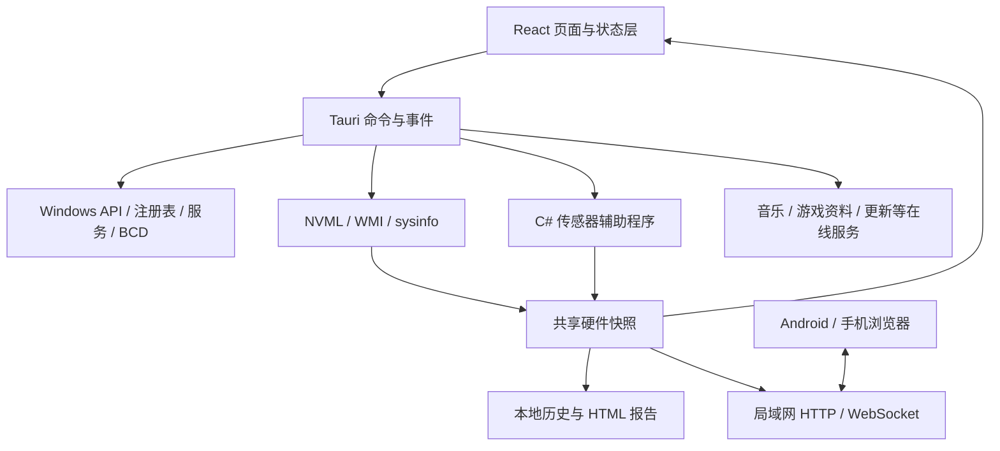

# NexBox 功能全景与实现分析

> 分析对象：[MuLiuSaMa/NexBox](https://github.com/MuLiuSaMa/NexBox)  
> 分析日期：2026-10-24  
> 源码快照：`main` / `e7ad6a0bb9197e206bb9a719ca86c6353a5cad43`  
> 提交时间：2026-10-11 16:51:26 +08:00；项目版本：`10.2.1`  
> 方法：路由、页面、状态层、Tauri 命令、Rust 实现、C# 监控程序、Android 源码与构建配置的静态交叉分析。

配套文档：

- [页面与原生命令索引](./NexBox-页面与原生命令索引.md)：60 个页面/面板文件、53 个声明式路由条目、629 个主程序注册命令。
- [系统优化配置项清单](./NexBox-系统优化配置项清单.md)：11 类、201 个配置项及其应用/恢复资源。

## 阅读导航

- [1. 核心结论](#1-核心结论)
- [2. 分析范围与可信度](#2-分析范围与可信度)
- [3. 产品结构与实现架构](#3-产品结构与实现架构)
- [4. 主页、导航与个性化](#4-主页导航与个性化)
- [5. 硬件监控与性能报告](#5-硬件监控与性能报告)
- [6. 游戏中桌面辅助](#6-游戏中桌面辅助)
- [7. 游戏与系统调优](#7-游戏与系统调优)
- [8. 存储与缓存维护](#8-存储与缓存维护)
- [9. NVIDIA、分辨率与音频](#9-nvidia分辨率与音频)
- [10. 三角洲行动专区](#10-三角洲行动专区)
- [11. Steam 与 Epic](#11-steam-与-epic)
- [12. 音乐播放与桌面歌词](#12-音乐播放与桌面歌词)
- [13. 下载加速与已有录屏管理](#13-下载加速与已有录屏管理)
- [14. 诊断、修复与维护工具](#14-诊断修复与维护工具)
- [15. 外部工具箱与社区生态](#15-外部工具箱与社区生态)
- [16. PC 与手机互联](#16-pc-与手机互联)
- [17. Android 端的独立功能范围](#17-android-端的独立功能范围)
- [18. 数据、联网与权限边界](#18-数据联网与权限边界)
- [19. 分发、工程化与维护特点](#19-分发工程化与维护特点)
- [20. 功能理解校正表](#20-功能理解校正表)
- [21. 仍需运行验证的重点](#21-仍需运行验证的重点)
- [22. 固定提交源码证据](#22-固定提交源码证据)

## 1. 核心结论

NexBox 是一个以 Windows 游戏场景为中心的桌面工具集合，已经发展出硬件监测、系统调优、桌面辅助、游戏平台管理、在线音乐、下载器，以及 Android 与 PC 互联等多个相对独立的子系统。

其特点是把系统底层操作和日常游戏工具放进统一界面：用户既能查看 CPU/GPU/FPS，也能修改进程亲和性、切换电源计划、管理 Steam 库、查询三角洲资料、播放音乐，并在手机端查看或控制 PC 的部分功能。[S01] [S02] [S03]

本次最值得注意的判断如下。

1. **功能范围明显大于 README 的概要。** 当前 `optimizerItems` 数组实际为 11 类、201 项；不能沿用 README 的旧数量，也不能把 629 个 IPC 命令当作 629 项独立用户功能。
2. **很多“优化”是系统状态修改。** 注册表、BCD、服务、驱动配置、电源计划与进程调度都有实际实现，不能概括成无副作用的“加速按钮”。
3. **同一产品内存在多种实现形态。** 准心、清理器等是原生实现；战绩和音乐依赖在线服务；部分工具是下载后运行第三方程序；心境、官方地图、驱动详情等属于网页嵌入或跳转。
4. **手机互联是真实子系统。** 包括设备发现、配对、令牌、白名单控制、实时状态、纯文本剪贴板同步、文件互传和音乐遥控；不是只有手机浏览器查看硬件数值。
5. **部分名称需要按实现重新解释。** “VT-X”主要控制 VBS/HVCI/Hyper-V 策略；“外设优化”修改调度和输入队列；“内存限制”改变 Windows 启动时可用内存；“NVIDIA 录屏管理”管理已有文件。
6. **“完全本地、无上传、零性能影响”等绝对表述不能由源码支持。** 存在首次启动版本/OS 统计、联网内容与后台采样服务；这不等同于发现了硬件报告或私人文件自动上传，二者需要区分。

## 2. 分析范围与可信度

### 2.1 什么已核对

已读取主要页面入口、关键共享状态、主程序原生命令注册表，以及各重点模块的函数实现。针对容易误判的功能，进一步追踪其实际效果、外部依赖和读写目标。系统优化项逐个检查了配置与 `.reg` 应用/恢复文件的对应关系。

源码引用均固定到本次提交，避免后续 `main` 更新造成引用内容漂移。源码参考副本及分析产物均在 D 盘。

### 2.2 什么没有验证

本次没有安装或运行 NexBox，没有执行它的系统优化、驱动安装、清理、账户登录及远程服务，也没有编译原仓库或验证线上接口响应。因而：

- “有页面与后端实现”表示源码链路存在，不表示所有机器上实测可用。
- “提供某优化”表示可以执行对应操作，不表示已测得 FPS、延迟或稳定性改善。
- 在线服务、账户登录、驱动版本、Windows 版本与商店政策都可能改变实际体验。
- 没有把未使用的翻译字符串、同名旧接口或注释中的计划功能直接计入已接通能力。

### 2.3 结构统计

| 对象                      | 本次统计 | 解释                                                                   |
| ------------------------- | -------: | ---------------------------------------------------------------------- |
| `src/pages` 直属 TSX 文件 |       60 | 含高级设置、CPU 隔离面板及独立窗口，不能都算独立主页面                 |
| `App.tsx` 声明式 Route    |       53 | 含别名、重定向、非商店版条件路由                                       |
| 常驻挂载入口              |        2 | 主页 `/`、工具页 `/tools`                                              |
| 独立窗口页面分支          |        5 | 灵动岛、桌面歌词、竖向悬浮、传感器、心境                               |
| 主程序注册命令路径        |      629 | `generate_handler!` 的不同注册路径；不是远程控制授权清单               |
| Windows 优化配置          |      201 | 按顶层配置对象计数，下拉变体不重复算项                                 |
| 优化分类                  |       11 | 游戏、GPU、性能、隐私、AI、服务、磁盘、应用、网络、资源管理器、音频    |
| 前端语言资源              |        6 | 简中、繁中、英语、法语、日语、德语；有资源不等于所有硬编码文本均已翻译 |

详细计数口径与全部入口见配套索引。[S01] [S04]

## 3. 产品结构与实现架构

### 3.1 用户看到的主要区域

主导航覆盖主页、硬件、工具箱、内置工具、优化、Windows 优化、音乐、三角洲、Steam、Epic、自定义面板和设置。导航显隐、排序与部分卡片显示可配置；各工具还可通过全局搜索访问。

全局搜索以本地搜索索引、译名与关键词匹配为主，也会合并第三方工具数据。实现是大小写归一后的字符串包含匹配，不应描述成语义搜索或 AI 搜索。[S05]

### 3.2 技术层次

| 层次           | 主要技术/模块                                                         | 职责                                              |
| -------------- | --------------------------------------------------------------------- | ------------------------------------------------- |
| 桌面 UI        | React 19、TypeScript、Vite、Chakra UI、Emotion                        | 主页面、表单、主题与工具界面                      |
| 状态/交互      | Zustand、React Context、React Router、i18next、DnD Kit、Framer Motion | 音乐状态、导航、国际化、拖动排序、动画            |
| 桌面桥接       | Tauri 2、store/dialog/opener/clipboard/shell 等插件                   | IPC、窗口、配置、本地文件与系统集成               |
| 原生系统能力   | Rust、Win32、WMI、sysinfo、NVML、NVAPI、注册表与系统命令              | 硬件查询、进程、电源、服务、显示、网络、文件管理  |
| 传感器辅助程序 | C# / .NET Framework、LibreHardwareMonitor                             | 读取底层传感器，通过标准输入/输出 JSON 与宿主通信 |
| 下载引擎       | 本地 `nx-dl-engine` crate                                             | 探测、分段、并发协调、恢复、限速、代理与策略学习  |
| 手机互联       | Axum、HTTP、WebSocket、UDP                                            | PC 服务端、设备发现、配对、状态推送与受限控制     |
| Android        | Kotlin、Jetpack Compose                                               | 本机硬件工具、PC 连接、遥控、文件与剪贴板互传     |
| 分发           | 独立安装器/卸载器、MSIX 构建脚本                                      | 桌面安装、更新和商店分发                          |

这里描述的是 NexBox 自身技术选型：它主要使用 Chakra UI、Lucide 与 Framer Motion，不是当前“新境”工程所选的 Tailwind CSS、Font Awesome 与 GSAP。[S02]

### 3.3 典型数据流

共享快照使主界面、悬浮层、报告和远程监控复用数据源。与此同时，硬件轮询、ETW、音频处理及网络服务仍有运行成本，需要实测后才能评价性能开销。

## 4. 主页、导航与个性化

### 4.1 主页卡片

主页组合了问候与用户名、硬件摘要、游戏快捷启动、公告、随机一言、随机图片、三角洲每日密码、游戏模式/Win 键管理、远程连接等信息，并提供反馈、文档、QQ群和心境等入口。具体卡片可在设置里显隐。

其中有些内容只是展示或引流，不能算系统能力：

- “今日人气”设置说明明确为随机数，不是由访问统计服务核实的真实在线人数。
- 心境页面载入 `https://www.nexbox.top/love` iframe，属于在线网页体验。
- 公告、赞助、交流群、广告等从远程数据源获取，可能因服务状态变化而缺失。

### 4.2 游戏启动与自定义面板

可选择本地 EXE，提取图标并保存快捷启动配置；对三角洲启动器提供检测与默认入口。自定义页面从内置搜索索引选择工具卡片，支持布局与卡片尺寸配置，配置保存到本地；源码主动排除了第三方工具类条目。

它是可定制的工具快捷面板，并未体现为任意代码插件、脚本市场或可视化编程系统。[S06]

### 4.3 外观和桌面体验

支持浅色/深色/跟随系统、主题色、字体、背景图/视频及玻璃效果等配置。提供启动动画、关闭行为、托盘、开机自启与最小化启动。全局快捷键覆盖悬浮框、准心、滤镜、连点器以及音乐控制，具有总开关和分项开关。

这些设置跨越 React 配置、WebView 本地存储、Tauri store 与原生窗口/热键实现，并非全部仅存于一个配置文件。[S07]

## 5. 硬件监控与性能报告

### 5.1 基础信息与实时状态

| 能力           | 用户可获得的信息                         | 主要实现/限制                                                  |
| -------------- | ---------------------------------------- | -------------------------------------------------------------- |
| 硬件信息       | CPU、GPU、内存、主板、磁盘和操作系统摘要 | WMI、sysinfo、设备枚举；字段取决于系统可提供的数据             |
| CPU/GPU 状态   | 使用率、频率、温度、功耗等可用指标       | NVIDIA NVML 与传感器辅助程序等数据源；不能保证所有品牌每项都有 |
| 内存/磁盘/网络 | 内存使用、磁盘空间及运行状态、网络速率等 | 部分数值来自共享悬浮快照与周期采样                             |
| 传感器详情     | 树状设备/传感器及原始读数                | 独立 SensorMonitor 窗口；辅助进程启动失败时可重启              |
| 硬盘健康       | 磁盘识别、SMART/健康字段                 | 控制器、USB 转接桥、磁盘协议和权限会限制可读字段               |
| 活动 GPU       | 选择当前展示显卡                         | 多显卡下需要识别/选择目标，不宜把所有读数理解成同一块 GPU      |

C# 监控端启用 CPU、GPU、主板和内存检测，处理设备异常和无效数值，并通过逐行 JSON 与 Rust 宿主交互。PawnIO 是获取更多底层指标的可选驱动，不安装并不等于整个软件无法使用。[S08]

### 5.2 FPS、帧时间和 Low FPS

FPS 模块在进程内启动 ETW 会话，监听 Windows 图形内核/窗口相关事件，追踪前台目标进程，进行同帧去重并计算 FPS、1% Low 和 0.1% Low。当前实现已移除旧的外部 PresentMon 子进程调用。

重要边界：

- 内核 Provider 需要管理员权限。
- 采样窗口、平滑算法、前台目标和系统事件可见性会影响数值。
- 不能把本工具的短窗口 Low FPS 与另一测试工具全程统计直接混为同一口径。
- 源码体现为系统事件采集，不应写成读取游戏内存实现的通用反作弊绕过能力。[S09]

### 5.3 历史记录与导出

硬件记录器在主程序 setup 阶段启动，复用快照并保存本地历史；内存环形缓冲上限为 3,600 条，磁盘历史读取范围最多 30 天。导出为包含图表脚本与数据的 HTML 报告，对大量数据进行采样，支持时间段查看、硬件摘要和统计图。

提供记录状态查询与清除本地历史命令。它是已经实现的本地历史报告系统，不只是“导出当前硬件型号”的静态文本文件。本次没有发现该报告模块自动上传整份硬件历史的链路。[S10]

## 6. 游戏中桌面辅助

### 6.1 硬件悬浮框与灵动岛

悬浮框展示 FPS、CPU/GPU、显存、内存、网络等状态，支持展示字段、外观、位置、多种布局、拖动与鼠标穿透配置；还可展示三角洲每日密码。竖向样式与桌面灵动岛拥有独立窗口页面。

桌面灵动岛用于通知、下载进度、播放等状态展示，可移出主窗口，主界面隐藏到托盘后继续显示；窗口支持根据光标位置切换穿透。不能把这里的“灵动岛”当成操作系统级的手机系统组件。[S11]

### 6.2 辅助准心

准心具有十字、点、圆形及组合样式；可调颜色、大小、粗细、间隙、透明度、中心点、描边与偏移。支持自定义图片、内置图片预设、用户预设、多显示器选择和全局热键。

“按住时启用”可绑定键盘或鼠标按键，并设置显示前延迟，释放后关闭。它提供屏幕覆盖层，不提供瞄准目标识别、自动压枪或游戏内部准星修改。[S12]

### 6.3 连点器和游戏 Win 键

连点器提供启动、停止、切换、参数更新与全局热键；游戏 Win 键控制基于游戏识别启用，避免游戏操作触发系统菜单。二者是输入行为辅助，实际可用性取决于前台应用、权限和游戏输入处理方式。

### 6.4 显示滤镜与 ICC

支持显示器枚举/选择、Gamma 能力检测、滤镜启停与参数更新、内置预设叠加、用户预设保存/导入导出、ICC 文件导入和预设应用，并提供 ICC 工具检测/下载。

其核心属于显示输出、Gamma/色彩配置处理，部分模式利用 NVIDIA 能力；不是对所有游戏都保证有效的游戏内着色器。HDR、驱动、显示器、独占全屏以及系统色彩管理可能改变效果。游戏识别和名单配置可参与滤镜自动行为。[S13]

## 7. 游戏与系统调优

### 7.1 游戏模式

游戏模式有默认、常规、竞技三档，并支持手动选择和游戏启动时自动切换。实现会识别游戏/前台进程及其进程家族，对不在豁免名单内的后台进程调整优先级、CPU 亲和性、I/O、内存、EcoQoS、GPU 调度等可用参数，并记录原值用于恢复。

系统关键进程、部分平台壳、音频/外设软件、反作弊和厂商控制软件被列入豁免逻辑。模式状态包括实际生效档位、是否检测到游戏、被处理进程数量等。

这是一套后台资源调度策略，不是修改游戏引擎渲染质量，也不能从“竞技”名称推断所有电脑都会更快。不同参数的获取/设置可能失败，恢复也依赖进程仍然存在及参数可写。[S14]

### 7.2 游戏进程优化、CPU 调度与隔离

| 功能             | 主要操作                                               | 状态与恢复                                 |
| ---------------- | ------------------------------------------------------ | ------------------------------------------ |
| 游戏进程优化     | 自定义 EXE/进程、优先级、亲和性、IFEO 参数、自动应用   | 保存按游戏配置，提供 IFEO 恢复入口         |
| CPU 调度         | 读取 CPU 拓扑、列出进程、查看/设置亲和性               | 可保存、删除、按进程名应用规则，支持恢复   |
| CPU 核心隔离面板 | 在 CPU 调度页内配置核心分配与隔离规则                  | 有状态、规则保存和还原接口；不是独立主路由 |
| 反作弊进程优化   | 按反作弊组调整优先级、亲和性、效率模式及部分 IFEO 设置 | 有组列表、自动检测、应用/恢复操作          |

这里的“反作弊优化”是对相关进程的资源调度操作，没有据此证明能关闭保护、避免封禁或绕过受保护进程限制。部分系统/驱动会拒绝修改，管理员权限也不保证所有目标都可操作。[S15]

### 7.3 内存清理

提供物理/虚拟内存、系统工作集、Standby 等详情，按项目清理内存，支持定时或阈值自动清理，以及游戏启动时触发清理。另有按磁盘查询/设置分页文件的能力。

必须区分三种不同操作：

1. 清理 Standby/工作集：改变当前内存驻留与缓存状态，释放统计值可能上升，但之后可能重新读盘。
2. 分页文件配置：改变 Windows 虚拟内存的磁盘配置。
3. 下文的系统可用内存限制：改变启动配置，不是普通清理，也不是限制某个游戏进程的内存。

### 7.4 “内存限制”的真实作用

`set_memory_limit` 根据物理内存和用户目标计算需移除的 MB，再执行 `bcdedit /set {current} removememory ...`；恢复执行 `/deletevalue ... removememory`。需要管理员权限并重启生效。

因此该工具会降低 Windows 启动后可用的系统内存。不能把它写成“游戏内存上限”“应用防爆内存”或无需重启的常规性能优化。[S16]

### 7.5 电源计划与高级电源设置

可列出内置/系统计划、读取当前方案、导入、激活、导入并激活、批量导入和删除计划。高级面板读取/设置电源参数并可取消隐藏部分设置。笔记本有解除部分电源计划限制的入口，可能需要重启。

它通过 Windows 电源配置工作，效果受现代待机、硬件和 OEM 管理软件影响，不能认为导入计划就一定能解锁所有平台的 CPU/GPU 功耗上限。

### 7.6 Windows 优化：11 类、201 项

| 分类             | 项数 | 代表性范围                                             |
| ---------------- | ---: | ------------------------------------------------------ |
| 游戏与图形       |   20 | 游戏调度、Game Bar/Game DVR、HAGS、MPO、前台优先策略等 |
| GPU              |   14 | GPU 功耗/时钟、驱动遥测、缓存及品牌相关配置            |
| 系统性能         |   33 | 调度、内存/缓存、后台行为及其他性能策略                |
| 隐私与权限       |   56 | 遥测、广告、位置、应用权限等系统策略                   |
| AI               |    9 | Copilot、Recall 等 Windows AI 相关策略                 |
| 系统服务         |   22 | 可选服务启动/禁用策略                                  |
| 磁盘             |    6 | 文件系统、维护与存储相关设置                           |
| 应用             |    6 | 系统应用及内容行为                                     |
| 网络             |   19 | TCP、网络栈与相关策略                                  |
| 资源管理器与交互 |   11 | 文件管理、桌面、输入与界面行为                         |
| 音频             |    5 | 音效、空间音频、通信衰减、服务/调度                    |

前端配置声明名称、分类、风险、渲染类型和 `.reg` 资源名；后端扫描当前注册表是否匹配目标配置，支持单项/批量应用和恢复。项目自身标签为低风险 123 项、中风险 68 项、高风险 10 项。

恢复采用预先编写的 `.restore.reg`，不是为每次修改自动保存完整的用户原始注册表快照。部分系统键可能随 Windows 版本失效；有配置文件也不代表实际提升有效。完整 201 项见配套清单。[S04] [S17]

### 7.7 网络优化

独立网络优化页提供 TCP 拥塞、Chimney offload、Nagle、网卡节能等状态检查、启用/恢复和批量操作；另外支持 DNS 延迟测试、预设/自定义 DNS、恢复 DNS、清理 DNS、网络重置、DHCP 修复和公网 IP 查询。

预设包括阿里、DNSPod、114、百度、Google、Cloudflare。DNS 延迟、网络测速、游戏 Ping 与网络栈参数是不同指标；不能把 DNS 响应更快直接等同于游戏服务器时延降低。[S18]

### 7.8 外设优化

页面实际写入三类值：

- `Win32PrioritySeparation`：Windows 前台/后台调度策略。
- `KeyboardDataQueueSize`：键盘类驱动输入队列。
- `MouseDataQueueSize`：鼠标类驱动输入队列。

恢复入口删除相应值。这里没有足够证据表明实现了更改鼠标固件/USB 轮询频率，因此应写作“调度与输入队列参数调整”，不能宣传为把鼠标提升到某个 Hz。[S19]

### 7.9 Windows 更新与虚拟化相关设置

Windows 更新页提供状态检测、暂停相关配置及禁用/恢复更新服务/策略；部分相关命令涉及 Defender 状态与注册表项。它不是独立提供系统补丁的更新服务。

“VT-X 虚拟化”页读取/修改 HVCI、VBS 和 `hypervisorlaunchtype`，通过注册表与 BCD 处理相关启动弹窗/兼容问题，并提供恢复入口。它无法代替 BIOS/UEFI 中的 CPU 硬件虚拟化开关，修改也可能影响依赖虚拟化的安全/开发环境。[S20]

## 8. 存储与缓存维护

### 8.1 存储清理与大文件扫描

存储页包含常见垃圾类别扫描、选项清理、回收站处理、Winapp2 规则信息/更新，以及磁盘选择、大文件扫描、取消扫描、定位与删除。大文件引擎有 NTFS MFT 相关实现，并存在其他扫描路径。

删除引擎维护系统目录、核心文件、分页文件和部分用户数据文件保护表；对可重建的系统缓存又做受限路径放行。应将其理解为源码中的保护机制，不能据此宣称任何清理组合都绝对不会误删。[S21]

### 8.2 显卡 Shader 缓存

扫描按厂商分组的缓存目录，展示目录、存在状态和占用，并进行清理；部分被占用文件有重启后处理状态。它主要处理驱动/系统缓存，与某个游戏内部自建的全部缓存并不等价。

### 8.3 三角洲 PSO 缓存

这项功能定位三角洲的 `Saved/PSOCache`，支持自动检测或手选、扫描统计、移入回收站或永久删除。源码对目录结构与游戏标识做校验；检测到游戏或部分启动器运行时拒绝清理，保留根目录与顶层 `.ini` 配置。

虽然页面使用了 UE/PSO 术语，但当前模块针对三角洲路径约束，不应扩写为任意 Unreal Engine 游戏通用的自动缓存管理器。[S22]

### 8.4 启动项、服务、应用和右键菜单

| 工具            | 功能                                        | 实现边界                                              |
| --------------- | ------------------------------------------- | ----------------------------------------------------- |
| 启动项管理      | 扫描、启用/禁用、文件定位、注册表定位、图标 | 覆盖代码中实现的启动来源，不保证枚举所有系统启动机制  |
| 系统服务        | 列出自动启动服务、状态/描述，修改启动类型   | 修改需要管理员；可能影响对应系统功能                  |
| 应用管理        | 扫描安装应用、图标、打开、调用卸载          | 主要编排系统已有安装/卸载机制，不是完整包管理器       |
| 右键菜单管理    | 扫描菜单项、隐藏/恢复                       | 注册表与 Shell 相关范围，不能保证覆盖每种新版扩展菜单 |
| 此电脑/磁盘显示 | 隐藏/恢复部分命名空间项目和驱动器显示       | 是资源管理器展示管理，不等于卸载设备或删除数据        |

## 9. NVIDIA、分辨率与音频

### 9.1 NVIDIA 驱动参数

通过 NVAPI 查询驱动版本、可用性、显示设备和驱动设置，设置/重置相关参数，并提供诊断。适用于 NVIDIA 驱动生态，不能推断为 AMD/Intel 同等功能的控制面板。

显卡名称修改则主要改变系统展示名称，有读取、应用、恢复和重启图形驱动入口；它不会改变 GPU 的实际型号、显存或性能。[S23]

### 9.2 DLSS 预设

三角洲 DLSS 页面提供模型预设、质量级别、纹理与抗锯齿选项，配有状态、指示器等开关。后端生成 `.nip` 配置文件，以管理员方式调用 NVIDIA Profile Inspector 导入；不是自己训练模型或重新实现 DLSS。

预设目录存在 A–G、J、K、L、M 等条目；实际是否支持由显卡、驱动和游戏决定。应用过程还包含多个相关驱动配置，不能理解成只修改一个独立字符串。保存的状态文件表示程序记录了应用结果，不能单独作为游戏当前实际渲染模型的检测证据。[S24]

### 9.3 分辨率换算与自定义显示模式

除了分辨率比例换算，页面还可读取 NVIDIA 显示模式、设置分辨率、查看/移除注入模式，并包含 EDID 模式注入路径。某些新模式需要重启后才供系统或游戏选择。

这属于显示驱动与系统显示模式配置，不能保证每台显示器接受任意分辨率/刷新率，也不能当作修改游戏内部渲染分辨率的通用 API。[S23]

### 9.4 NVIDIA 驱动查找

可检测当前 NVIDIA GPU、获取并缓存驱动版本列表，区分台式机/笔记本入口。当前页面按钮调用 `handleOpenDetail(detail_url)`，打开官方详情页；因此准确描述是驱动查找和官网引导，不能由页面名称推断已经在应用内完成下载、安装和回滚。

此页面路由在 Store 构建中被条件隐藏。[S25]

### 9.5 音频均衡器

音频功能不仅是播放器内音量设置：它有 FXVAD 虚拟音频驱动检测/安装/卸载、输入/输出设备选择、WASAPI 原生处理引擎、EQ 频段、前级增益、频谱/电平与音效参数。

前端提供 5/10/15/20/31 段布局及频率调整；音效含清晰度、环境、宽度、动态与低音。预设支持保存、导入、删除和 FAC 导出。处理链路是虚拟设备回环采集 → EQ/DSP → 物理输出，而不是把每个游戏的音频配置文件逐个修改。

驱动安装需要系统目录/驱动注册等操作，可能重启；音频路由、设备切换、延迟和独占模式兼容性仍需实际设备验证。[S26]

## 10. 三角洲行动专区

### 10.1 每日密码

提供在线每日密码，使用主接口并在失败/空数据时回退备用接口，有短时缓存；密码可显示在主页和悬浮框，并支持选定地图过滤。它是外部信息聚合，日期正确性和接口更新速度依赖上游。

### 10.2 改枪码社区

当前主要界面调用 `df.nexbox.top` 的分类、武器和配装接口，支持筛选、浏览、复制、提交配装/改枪码和报告不可用条目。还有其他改枪码平台入口。

后端另保留 `get_weapon_codes` 的少量固定示例数据，值形如 `DELTA-M4A1-001`。该旧接口不能作为真实社区数据覆盖范围的证据；当前页面的主要路径是在线 API。[S27]

### 10.3 随机装备

根据本地装备资料随机生成地图/难度、干员、武器/弹药、头盔、护甲及任务，提供候选滚动展示与偏好运/坏运等玩法。普通难度会裁剪不符合等级规则的装备池；图片支持缓存。

它是娱乐配置生成器，不会自动购买装备、操作游戏仓库或操控角色。[S28]

### 10.4 战绩与数据分析

有 QQ/微信二维码登录、登录轮询、缓存读取/刷新、退出登录、赛季报告、单局详情和地图统计等链路，前端展示战绩、藏品及相关统计，使用干员、地图、皮肤等字典辅助解析。

这部分依赖腾讯/WeGame 相关登录和数据接口。登录失效、接口字段变化、访问频率与账号可见权限会影响数据；不应将源码存在视为当前线上登录和全部统计已实测通过。[S29]

### 10.5 主播配置与官方资源

主播目录与详情展示游戏设置、显示器、鼠标灵敏度、NVIDIA 控制面板/App、音频、Steam 启动参数、电脑和外设等资料，可复制部分配置。未填写的类别会显示无数据，不代表程序能自动探测该主播的真实设备配置。

官方地图、壁纸及部分平台通过网页/外部窗口提供，不能与本地实现的地图编辑器、离线完整资料库混淆。[S30]

## 11. Steam 与 Epic

### 11.1 Steam 本地管理

可检测 Steam 安装/运行状态，读取本地账号、头像、游戏库、已安装游戏、磁盘占用、库存缓存和游玩信息，支持搜索游戏、启动客户端/游戏、打开目录/商店页，以及发起安装和卸载请求。

账户管理读取 Steam 已保存的本地账号，提供切换和删除本地账号记录；部分操作会关闭 Steam。这里的“删除账号”不是注销 Steam 云端账户，“切换账号”也不意味着能绕过密码、Steam Guard 或当前授权状态。

库存与已安装游戏采用不同来源和口径，缓存数据并不等于实时完整的在线资产查询。[S31]

### 11.2 Epic 免费游戏

通过在线接口展示当前免费游戏、封面和截止时间，点击进入领取页面。源码体现的是信息查询与跳转，不是已实现后台自动登录、自动下单或自动领取全流程。

## 12. 音乐播放与桌面歌词

### 12.1 音源与浏览

音乐系统接入网易云、酷狗、QQ 音乐、咪咕、汽水，以及本地音乐。它有跨平台选择、登录状态、搜索、歌单、排行榜或推荐、歌手与专辑等能力，但各平台支持程度不同，不能用统一按钮推断所有提供方功能完全一致。

本地音乐支持文件/目录导入、元信息、封面与本地歌词处理。在线播放通过 Rust 获取数据/音源并结合本地音频代理，前端维护播放队列与状态。[S32] [S33]

### 12.2 播放器能力

- 播放/暂停、上一首/下一首、进度拖动、音量/静音。
- 队列管理、列表循环、随机、单曲循环，部分来源有心动/推荐模式。
- 搜索历史、播放历史、收藏/歌单相关操作及音质选择。
- 展开播放器、全屏/碟片等样式、封面配色和歌词/翻译展示。
- 部分平台提供评论读取与发送；不支持的平台会明确显示提示。
- Windows SMTC、键盘媒体键、全局音乐热键，以及灵动岛/桌面歌词协同。

页面提供高音质或会员音质选项，不代表获得对应平台会员授权；实际可播放内容仍由账号权益、接口与返回音源决定。

### 12.3 已确认的平台差异

| 范围    | 源码中可确认的差异                                                                                                        |
| ------- | ------------------------------------------------------------------------------------------------------------------------- |
| 网易云  | 接口覆盖搜索、歌曲 URL、QR 登录、歌单、喜欢、歌词、评论、推荐、歌手、专辑与 MV URL 等；不同接口是否都有完整 UI 需逐条区分 |
| 酷狗    | 搜索、登录、歌单、榜单、猜你喜欢、喜欢与歌词等独立实现                                                                    |
| QQ 音乐 | 当前状态层只读账号收藏，主动阻止写回红心；不能把后端同名接口等同于前端已开放写入                                          |
| 咪咕    | 状态层注明暂不支持红心读取/收藏，其他搜索/播放/歌单能力分别实现                                                           |
| 汽水    | 有独立 QR、用户状态、歌单、喜欢、Feed、搜索、依赖检测/下载与音源处理流程                                                  |
| 本地    | 文件/目录、元信息与歌词，不需要按在线平台接口理解                                                                         |

评论能力也按平台受限。项目没有在主包中体现一个独立、完整的“全平台音乐下载管理器”；不能把音源解析或播放缓存直接描述成批量下载歌曲功能。[S32] [S34]

### 12.4 桌面歌词

拥有独立透明顶置窗口，支持显示同步、位置、外观、鼠标穿透与解锁交互，以及窗口位置校准。歌词与主播放器状态通过组件/事件协同；不是在每个游戏渲染管线内注入歌词。

## 13. 下载加速与已有录屏管理

### 13.1 下载加速器

提供 URL 输入、保存位置、自动/指定最大连接数、开始、暂停、恢复、取消、任务列表、完成文件打开/定位、全局限速及未完成任务扫描。

宿主调用 `nx-dl-engine`，包含资源探测、动态分段、并发协调、单流回退、分段进度、代理配置和按域名学习连接策略。学习缓存可以重置，说明它会积累站点行为，而不只是固定把每次下载拆成相同线程数。

是否更快取决于服务器是否支持 Range、多连接策略、网络和限速；不能保证任意链接都提速，也没有据此确认 BT、磁力、网盘账号解析或全浏览器下载接管。[S35]

### 13.2 NVIDIA 录屏文件管理

扫描已有视频目录，按时间展示录制文件，支持目录添加/移除、缩略图、系统播放器打开、资源管理器定位、复制和删除。

当前路由/命令对应的是已有文件管理，没有找到此页面调用屏幕捕获、编码、开始录制或停止录制的实现。语言包虽然保留 `screenRecord` 的完整录制界面文案，但不能据此认定该版本已有独立屏幕录制器。[S36]

## 14. 诊断、修复与维护工具

| 工具             | 已实现的能力                                                                                | 应准确理解的边界                                                             |
| ---------------- | ------------------------------------------------------------------------------------------- | ---------------------------------------------------------------------------- |
| 网络测速         | 服务器列表、开始/停止、延迟及上下行相关测试                                                 | 测到的是测试节点链路，不是所有游戏实际线路                                   |
| 时间同步         | 查询 NTP 服务器、偏差展示、管理员校时                                                       | 修改系统时间，不是更换互联网服务商时间源                                     |
| 屏幕测试         | 12 类全屏图样：坏点、渐变、响应、刷新率、均匀性、撕裂、子像素、黑阶、灰阶、文本、几何、视角 | 主要供目测，rAF 统计受多屏/DWM 影响，不替代专业仪器                          |
| 蓝屏日志         | 汇总事件日志、Minidump、BugCheck 知识，展示记录/归因/建议，定位转储                         | 没有集成 WinDbg 与符号服务，不是严格完成内核调试归因                         |
| 运行库修复       | VC++ 多版本 x86/x64、.NET Framework 4.8.1、旧 DirectX 兼容组件检测/下载/签名验证/安装       | .NET Framework 不等于现代 .NET SDK；旧 DirectX 组件不等于升级系统 DirectX 12 |
| VAC 修复         | Steam 状态检查，管理员运行修复流程并逐行回传日志                                            | 处理本地服务/环境问题，不是解除 VAC 封禁                                     |
| Windows 隐藏特性 | 查询、设置、重置 FeatureManagement 特性状态                                                 | 受具体 Windows Build 和 Feature ID 约束，不能保证开启任何隐藏功能            |
| 图形驱动重启     | 请求系统重新启动显示驱动链路                                                                | 不是重装显卡驱动或硬件修复                                                   |

运行库修复代码明确从微软 URL 获取安装器并验证 Microsoft Authenticode 签名；蓝屏模块明确说明没有 Windbg/符号服务。以上属于源码可核对的范围，不是本次实测结果。[S37] [S38] [S39]

## 15. 外部工具箱与社区生态

工具箱包含官方推荐、社区工具、第三方工具和外设驱动等数据源。其功能层次包括：获取目录、类别/搜索、状态检测、下载位置、下载/解包、选择 ZIP 内 EXE、运行工具或打开安装器。

社区侧还有 GitCode 登录、提交工具、删除自己管理的条目，以及图标/包选择等接口。并非所有列表条目都内置在 NexBox 可执行文件里，也不是 NexBox 自己实现了这些外部软件的完整功能。

例如页面中出现 Steam++、图吧工具箱、火绒、动态壁纸和启动器，只能说明它们是推荐/下载/启动入口，不能把这些产品的全部能力计为 NexBox 原生功能。

目录和包由外部源提供，具体供应、下载链接和可运行状态需要联网验证；当前静态分析不保证每一项仍可下载。[S40]

## 16. PC 与手机互联

### 16.1 两套不同的远程入口

| 入口                 | 连接方式                                       | 主要能力                                         |
| -------------------- | ---------------------------------------------- | ------------------------------------------------ |
| 手机浏览器远程监控   | PC 开 HTTP 服务、手机访问地址并输入访问码      | 查看实时硬件，切换卡片/列表/大屏样式；主要是监控 |
| Android 原生远程接入 | UDP 发现 + 配对码/PC 审批 + 设备令牌 + HTTP/WS | 状态、受限动作、音乐、剪贴板和文件互传           |

两者使用不同状态、路由与鉴权逻辑，不能把旧监控页的访问码机制直接当成新版所有控制接口的权限设计。[S41] [S42]

### 16.2 新远程接入的连接流程

1. 用户开启 PC 远程接入；开启状态可持久化，下次启动自动恢复。
2. Android 使用 UDP `45689` 发现 PC，或用连接信息进行配对。
3. 6 位配对码默认有效 5 分钟；也支持手机发起请求、PC 手动批准。
4. 服务签发长期随机设备令牌，PC 持久化令牌哈希；最多 10 台设备。
5. 控制使用 Bearer 令牌，实时状态通过 WebSocket；PC 可查看/撤销设备并断开连接。

配对失败有按 IP 的计数/短时锁定，审批请求也有限时和数量上限。服务绑定 `0.0.0.0` 的动态 HTTP 端口，未看到此监听链路配置 TLS。因此“用于局域网”是设计用途，不能把它表述为只绑定某一个局域网地址或已具备端到端加密的公网控制服务。[S42] [S43]

### 16.3 精选控制白名单

能力元数据按 9 组提供 14 个查询与 15 个动作：

| 分组       | 查询/状态                | 可写动作                                 |
| ---------- | ------------------------ | ---------------------------------------- |
| 硬件       | 实时快照、磁盘、硬件型号 | 无                                       |
| 内存与清理 | 内存状态                 | 一键内存优化、清理临时文件               |
| 电源       | 当前/可用电源计划        | 切高性能、激活指定计划                   |
| 游戏模式   | 模式状态                 | 选择档位、自动切换                       |
| 滤镜       | 当前滤镜设置             | 开/关                                    |
| 悬浮框     | 状态                     | 切换                                     |
| 准心       | 状态                     | 切换                                     |
| 应用       | 安装应用列表             | 无远程卸载动作                           |
| 音乐       | 播放状态、歌词、系统音量 | 播放/暂停、上一首/下一首、跳转、系统音量 |

实际路由分发还受 `actions.rs` 限制。并非将桌面 629 个命令直接暴露到网络；注册表批量优化、驱动安装和应用卸载等不在此白名单。

不过白名单包含 `sys.clean_temp`，确实会清理文件，因此不能照搬注释中“无删除”的绝对说法。也未发现通用远程桌面画面流、任意键鼠控制或远程 Shell 作为该白名单能力。[S44]

### 16.4 文件互传

采用每设备独立“文件篮”：PC outbox 等待手机下载；手机文件进入 PC inbox 后可另存为。元数据持久化，传输有进度/速率、完成回执及 WebSocket 刷新；上传/下载流式处理，使用 `.part` 临时文件和完成后改名。

这不是整盘共享或任意路径的远程文件管理器。原生服务与手机端都存在打开、保存等本地交互，接收文件仍需要用户在相应端处理。[S45]

### 16.5 剪贴板与音乐遥控

剪贴板同步针对纯文本，PC 每秒轮询发送变化，单段上限为 512 KiB，并用内容指纹抑制回环。**PC 的同步开关只控制 PC → 手机的发送**；已鉴权手机 → PC 的接收写入不受这个开关控制。相同内容连续复制可能不会再次发送。不能推断为自动同步图片、富文本、文件或全部历史。

音乐遥控统一处理 NexBox 内播放器与 Windows 外部 SMTC 会话，支持状态、播放控制、进度和系统主音量；歌词有单独查询/缓存路径。外部软件只有在提供可用系统媒体会话时才能配合，不是所有应用音频都能被识别为歌曲。[S46]

## 17. Android 端的独立功能范围

仓库包含 Kotlin/Compose 原生 Android 应用，并非简单把桌面 React 页面搬入手机 WebView。底部导航为主页、本机、工具、三角洲、设置。

主要能力包括：

- 手机本机硬件/运行状态读取及详情展示。
- Android 悬浮监控和准心的配置，依赖悬浮窗/前台服务权限。
- PC 搜索、扫码/配对、连接会话、实时 PC 状态及白名单控制。
- 文件互传、纯文本剪贴板同步、音乐遥控。
- 三角洲密码/改枪码/随机装备等资料与娱乐工具。
- 网络测速、Epic 免费游戏信息、心境入口、应用设置和 APK 更新流程。

Android 清单包含网络、相机、悬浮窗、前台服务、通知、APK 安装相关权限；旧 Android 文件保存有特定存储权限回退。不要把 PC 的注册表、驱动、电源、Steam 本地库管理等能力写成 Android 本机也有。

源码存在 `PlaceholderScreen.kt`，但没有发现其被当前主导航使用；单独存在这个文件不能证明某个已展示模块只是占位。同样，PC 独有工具也不应因为移动端文件名相似就视作完整移植。[S47]

## 18. 数据、联网与权限边界

### 18.1 本地数据

主要存储形态包括 Tauri store/JSON、WebView localStorage、AppData/LocalAppData 下的缓存与日志、程序目录的个别状态文件、临时下载与安装文件，以及系统注册表/BCD/服务配置。

会涉及账号登录状态/Cookie、游戏路径与配置、音乐状态/封面/歌词、硬件采样历史、配对设备与令牌哈希、传输文件篮、下载任务/站点策略等。不同模块的数据位置和清除范围不完全相同，不能理解为删除一个 `settings.json` 就彻底清空全部数据。

**与本次 D 盘约束的关系：** 本次只在 D 盘读取源码副本和生成文档。NexBox 原程序本身使用 Windows AppData、TEMP，部分驱动还明确写入系统驱动目录；并不是一个天然满足“禁止写 C 盘”的便携程序。因此本次没有运行它来验证系统功能。[S07] [S26]

### 18.2 已核对的联网用途

| 用途         | 源码中的行为                                                                           | 对使用体验的影响                                     |
| ------------ | -------------------------------------------------------------------------------------- | ---------------------------------------------------- |
| 首次启动统计 | PC POST `mc.sjtu.cn/api-sjmcl/statistics`，请求体包含 `box-版本` 与 OS；写独立发送标志 | 不能说整个产品完全无统计请求；未据此发现上传私人文件 |
| Android 统计 | 有相同统计服务的首次报告逻辑                                                           | 移动端也不是完全无联网的本机工具                     |
| 音乐         | 多家平台登录、搜索、音源、歌词、评论/歌单等                                            | 内容、权益、登录与接口稳定性依赖平台                 |
| 游戏内容     | 密码、改枪码、战绩、主播/图片等                                                        | 缓存不能代替上游持续供给                             |
| 展示/维护    | 公告、广告、赞助、工具目录、更新等                                                     | 不宜描述成所有内容均离线内置                         |
| 网络工具     | 测速、NTP、DNS 测试、公网 IP 等                                                        | 会主动产生相应网络请求                               |
| 局域网服务   | 远程监控、远程接入、文件和剪贴板                                                       | 用户开启后产生本地网络服务与传输                     |

PC 统计发送逻辑不论发送成功与否都会尝试写标志，故这里的“首次”是程序标志控制，并不等价于服务端保证只记一次。未运行程序，无法给出实际抓包结论。[S48]

### 18.3 桌面权限配置

Tauri 配置的 CSP 为 `null`，asset protocol scope 为 `**`，能力文件向指定窗口开放多种窗口、文件、剪贴板和外部打开能力。需要结合窗口来源、实际调用路径和运行版本评估边界，不能只看到 Tauri 就认定采用最小权限设计，也不能仅凭这些配置断言存在可利用漏洞。[S49]

## 19. 分发、工程化与维护特点

### 19.1 多构建形态

普通桌面版与 Store 版有不同入口控制。`VITE_STORE_BUILD`、独立 Tauri Store 配置及 MSIX 脚本共同参与构建；外部工具导航、NVIDIA 驱动官网下载页等会隐藏。入口隐藏不等同于后端命令、依赖和代码全部裁剪，不能仅凭 UI 条件判断商店包实际能力面。

仓库还有独立安装器和卸载器：安装路径、空间检测、资源安装、取消、启动，以及卸载信息、卸载进度和自删除等。主 Tauri 配置 `bundle.active` 为 false，结合独立分发项目理解更准确。[S50]

### 19.2 现有质量控制

有 TypeScript/Vite 构建、ESLint、Prettier、Husky 与 GitHub CI。CI 包含 Web 构建及 Windows `cargo check`；没有在该 CI 中看到完整运行时/E2E/系统优化回滚测试矩阵。不能把 CI 配置存在写成所有硬件与 Windows 版本都经过验证。

工程按照 Rust 功能模块划分，但部分页面和模块很大：例如显示滤镜约 5,922 行、综合 optimization 模块约 5,428 行，音乐页面/状态和多平台 API 也承担大量职责。功能耦合主要发生在游戏识别、共享硬件快照、全局设置、多窗口事件与进程状态之间。[S51]

### 19.3 源码复用时需要注意的事实

主项目声明 GPL-3.0，本地下载引擎声明 AGPL-3.0，并注明源自 FluxDown。涉及代码、二进制资源、驱动、字体/图片或第三方软件时，应分别核对各自许可与来源，不能根据主仓库一个许可字段判断所有资源的使用条件。

主 Rust 包标注 `rust-version = 1.77.2`，下载引擎采用 edition 2024 并标注 1.85；完整构建至少受更高的依赖要求约束，不能将旧 README 的 1.77.2 当作整个项目已验证的最低版本。本次没有编译，无法给出确切最低可构建工具链。[S52]

## 20. 功能理解校正表

| 容易产生的理解                         | 源码支持的准确说法                                          |
| -------------------------------------- | ----------------------------------------------------------- |
| 这是一个只有硬件检测和一键加速的小工具 | 多子系统桌面工具集，还含音乐、下载、社区工具与 Android 互联 |
| Windows 优化固定为 README 的旧数量     | 当前配置数组为 11 类、201 项                                |
| 629 个接口就是 629 个用户功能          | 一个功能常需多条读取/设置/恢复接口，另有窗口和辅助接口      |
| 内存限制只是限制某个游戏               | 修改 Windows BCD 的 removememory，重启后影响系统可用内存    |
| 外设优化能直接提高鼠标 USB Hz          | 当前主要是调度与键鼠队列注册表参数                          |
| VT-X 页能替代 BIOS 虚拟化开关          | 当前主要操作 VBS、HVCI 和 Hyper-V 启动策略                  |
| NVIDIA 录屏页就是录制器                | 当前是已有视频目录、缩略图、打开/复制/删除管理              |
| 显卡改名能改变 GPU 性能                | 更改展示名称，硬件不变                                      |
| 驱动下载页已经做了应用内安装           | 当前按钮主要打开 NVIDIA 官方详情页                          |
| Epic 可以自动领取                      | 当前是列表与领取页面跳转                                    |
| Steam 删除账号等于注销云端账户         | 当前是本地已保存账号记录管理                                |
| 全平台音乐操作完全一致                 | 平台支持不同，QQ/咪咕收藏等有明确限制                       |
| 手机上能调用全部桌面命令               | 新远程接入受精选查询/动作白名单约束                         |
| 远程接入就是远程桌面                   | 没有据此确认通用屏幕流、键鼠遥控与 Shell                    |
| 所有功能都原生内置且离线               | 真实实现混合本地、在线 API、网页和第三方程序                |
| 恢复按钮一定恢复用户原始值             | 很多功能执行预设恢复文件或删除值，不能等同完整快照回滚      |
| 已证明无上传、零性能开销               | 有版本/OS 统计和后台采样；真实隐私流量与性能需抓包/测量     |

## 21. 仍需运行验证的重点

若后续需要将本报告升级为“可用性实测报告”，应在可回滚的专用环境分别验证：

1. 标准用户/管理员权限，Windows 不同 Build，独显/核显/混合显卡与不同磁盘控制器。
2. 传感器可见字段、PawnIO 兼容性、FPS 口径和报告完整性。
3. 游戏模式、反作弊进程、IFEO、核心分配在进入/退出游戏后的应用与恢复行为。
4. 注册表优化、BCD、电源、服务和驱动的实际变更与重启后状态；不能在日常系统全选执行来替代验证。
5. 音乐/战绩登录、线上资料与更新端点的当前可达性及账号权益差异。
6. 手机发现、配对撤销、网络断开重连、文件大包/取消、剪贴板开关及外部音乐会话。
7. 普通版、Store 包和 Android APK 各自真实暴露的入口与资源完整性。

以上是静态分析留下的验证边界，不是本次已执行清单。

## 22. 固定提交源码证据

引用链接对应本次固定提交；附录还提供每个页面和所有注册命令的逐项定位。

| 编号 | 主要源码位置                                                                                                                                                                               |
| ---- | ------------------------------------------------------------------------------------------------------------------------------------------------------------------------------------------ |
| S01  | [src/App.tsx#L78](https://github.com/MuLiuSaMa/NexBox/blob/e7ad6a0bb9197e206bb9a719ca86c6353a5cad43/src/App.tsx#L78)                                                                       |
| S02  | [package.json#L1](https://github.com/MuLiuSaMa/NexBox/blob/e7ad6a0bb9197e206bb9a719ca86c6353a5cad43/package.json#L1)                                                                       |
| S03  | [src-tauri/src/lib.rs#L604](https://github.com/MuLiuSaMa/NexBox/blob/e7ad6a0bb9197e206bb9a719ca86c6353a5cad43/src-tauri/src/lib.rs#L604)                                                   |
| S04  | [src/config/system-optimizer.ts#L109](https://github.com/MuLiuSaMa/NexBox/blob/e7ad6a0bb9197e206bb9a719ca86c6353a5cad43/src/config/system-optimizer.ts#L109)                               |
| S05  | [src/components/ui/global-search.tsx](https://github.com/MuLiuSaMa/NexBox/blob/e7ad6a0bb9197e206bb9a719ca86c6353a5cad43/src/components/ui/global-search.tsx)                               |
| S06  | [src/pages/CustomPage.tsx#L50](https://github.com/MuLiuSaMa/NexBox/blob/e7ad6a0bb9197e206bb9a719ca86c6353a5cad43/src/pages/CustomPage.tsx#L50)                                             |
| S07  | [src/pages/SettingsPage.tsx](https://github.com/MuLiuSaMa/NexBox/blob/e7ad6a0bb9197e206bb9a719ca86c6353a5cad43/src/pages/SettingsPage.tsx)                                                 |
| S08  | [monitor/Program.cs](https://github.com/MuLiuSaMa/NexBox/blob/e7ad6a0bb9197e206bb9a719ca86c6353a5cad43/monitor/Program.cs)                                                                 |
| S09  | [src-tauri/src/game_fps.rs#L1](https://github.com/MuLiuSaMa/NexBox/blob/e7ad6a0bb9197e206bb9a719ca86c6353a5cad43/src-tauri/src/game_fps.rs#L1)                                             |
| S10  | [src-tauri/src/hardware_report.rs#L12](https://github.com/MuLiuSaMa/NexBox/blob/e7ad6a0bb9197e206bb9a719ca86c6353a5cad43/src-tauri/src/hardware_report.rs#L12)                             |
| S11  | [src/pages/OverlayPanelPage.tsx](https://github.com/MuLiuSaMa/NexBox/blob/e7ad6a0bb9197e206bb9a719ca86c6353a5cad43/src/pages/OverlayPanelPage.tsx)                                         |
| S12  | [src/pages/CrosshairPage.tsx](https://github.com/MuLiuSaMa/NexBox/blob/e7ad6a0bb9197e206bb9a719ca86c6353a5cad43/src/pages/CrosshairPage.tsx)                                               |
| S13  | [src-tauri/src/display_filter.rs#L2545](https://github.com/MuLiuSaMa/NexBox/blob/e7ad6a0bb9197e206bb9a719ca86c6353a5cad43/src-tauri/src/display_filter.rs#L2545)                           |
| S14  | [src-tauri/src/game_mode.rs#L1](https://github.com/MuLiuSaMa/NexBox/blob/e7ad6a0bb9197e206bb9a719ca86c6353a5cad43/src-tauri/src/game_mode.rs#L1)                                           |
| S15  | [src/pages/GameProcessOptimizePage.tsx](https://github.com/MuLiuSaMa/NexBox/blob/e7ad6a0bb9197e206bb9a719ca86c6353a5cad43/src/pages/GameProcessOptimizePage.tsx)                           |
| S16  | [src-tauri/src/optimization.rs#L1192](https://github.com/MuLiuSaMa/NexBox/blob/e7ad6a0bb9197e206bb9a719ca86c6353a5cad43/src-tauri/src/optimization.rs#L1192)                               |
| S17  | [src-tauri/src/optimization.rs#L4562](https://github.com/MuLiuSaMa/NexBox/blob/e7ad6a0bb9197e206bb9a719ca86c6353a5cad43/src-tauri/src/optimization.rs#L4562)                               |
| S18  | [src-tauri/src/network_optimize.rs#L119](https://github.com/MuLiuSaMa/NexBox/blob/e7ad6a0bb9197e206bb9a719ca86c6353a5cad43/src-tauri/src/network_optimize.rs#L119)                         |
| S19  | [src-tauri/src/optimization.rs#L4204](https://github.com/MuLiuSaMa/NexBox/blob/e7ad6a0bb9197e206bb9a719ca86c6353a5cad43/src-tauri/src/optimization.rs#L4204)                               |
| S20  | [src-tauri/src/vtx_virtualization.rs#L192](https://github.com/MuLiuSaMa/NexBox/blob/e7ad6a0bb9197e206bb9a719ca86c6353a5cad43/src-tauri/src/vtx_virtualization.rs#L192)                     |
| S21  | [src-tauri/src/storage_scan/safety_constants.rs#L1](https://github.com/MuLiuSaMa/NexBox/blob/e7ad6a0bb9197e206bb9a719ca86c6353a5cad43/src-tauri/src/storage_scan/safety_constants.rs#L1)   |
| S22  | [src-tauri/src/pso_cache.rs#L1](https://github.com/MuLiuSaMa/NexBox/blob/e7ad6a0bb9197e206bb9a719ca86c6353a5cad43/src-tauri/src/pso_cache.rs#L1)                                           |
| S23  | [src-tauri/src/nvapi.rs#L1227](https://github.com/MuLiuSaMa/NexBox/blob/e7ad6a0bb9197e206bb9a719ca86c6353a5cad43/src-tauri/src/nvapi.rs#L1227)                                             |
| S24  | [src-tauri/src/delta_force.rs#L294](https://github.com/MuLiuSaMa/NexBox/blob/e7ad6a0bb9197e206bb9a719ca86c6353a5cad43/src-tauri/src/delta_force.rs#L294)                                   |
| S25  | [src/pages/NvidiaDriverDownloadPage.tsx#L469](https://github.com/MuLiuSaMa/NexBox/blob/e7ad6a0bb9197e206bb9a719ca86c6353a5cad43/src/pages/NvidiaDriverDownloadPage.tsx#L469)               |
| S26  | [src-tauri/src/audio_engine.rs#L1](https://github.com/MuLiuSaMa/NexBox/blob/e7ad6a0bb9197e206bb9a719ca86c6353a5cad43/src-tauri/src/audio_engine.rs#L1)                                     |
| S27  | [src/pages/DeltaForcePage.tsx#L100](https://github.com/MuLiuSaMa/NexBox/blob/e7ad6a0bb9197e206bb9a719ca86c6353a5cad43/src/pages/DeltaForcePage.tsx#L100)                                   |
| S28  | [src/pages/DeltaForceRoulettePage.tsx#L65](https://github.com/MuLiuSaMa/NexBox/blob/e7ad6a0bb9197e206bb9a719ca86c6353a5cad43/src/pages/DeltaForceRoulettePage.tsx#L65)                     |
| S29  | [src-tauri/src/df_stats.rs#L538](https://github.com/MuLiuSaMa/NexBox/blob/e7ad6a0bb9197e206bb9a719ca86c6353a5cad43/src-tauri/src/df_stats.rs#L538)                                         |
| S30  | [src/pages/StreamerProfilePage.tsx](https://github.com/MuLiuSaMa/NexBox/blob/e7ad6a0bb9197e206bb9a719ca86c6353a5cad43/src/pages/StreamerProfilePage.tsx)                                   |
| S31  | [src-tauri/src/steam.rs#L958](https://github.com/MuLiuSaMa/NexBox/blob/e7ad6a0bb9197e206bb9a719ca86c6353a5cad43/src-tauri/src/steam.rs#L958)                                               |
| S32  | [src-tauri/src/music_api/mod.rs#L23](https://github.com/MuLiuSaMa/NexBox/blob/e7ad6a0bb9197e206bb9a719ca86c6353a5cad43/src-tauri/src/music_api/mod.rs#L23)                                 |
| S33  | [src-tauri/src/music.rs#L326](https://github.com/MuLiuSaMa/NexBox/blob/e7ad6a0bb9197e206bb9a719ca86c6353a5cad43/src-tauri/src/music.rs#L326)                                               |
| S34  | [src/stores/music-store.ts#L3205](https://github.com/MuLiuSaMa/NexBox/blob/e7ad6a0bb9197e206bb9a719ca86c6353a5cad43/src/stores/music-store.ts#L3205)                                       |
| S35  | [src-tauri/src/download_accelerator.rs#L1](https://github.com/MuLiuSaMa/NexBox/blob/e7ad6a0bb9197e206bb9a719ca86c6353a5cad43/src-tauri/src/download_accelerator.rs#L1)                     |
| S36  | [src-tauri/src/nvidia_recording.rs#L180](https://github.com/MuLiuSaMa/NexBox/blob/e7ad6a0bb9197e206bb9a719ca86c6353a5cad43/src-tauri/src/nvidia_recording.rs#L180)                         |
| S37  | [src-tauri/src/runtime_repair.rs#L1](https://github.com/MuLiuSaMa/NexBox/blob/e7ad6a0bb9197e206bb9a719ca86c6353a5cad43/src-tauri/src/runtime_repair.rs#L1)                                 |
| S38  | [src-tauri/src/bsod_log.rs#L1](https://github.com/MuLiuSaMa/NexBox/blob/e7ad6a0bb9197e206bb9a719ca86c6353a5cad43/src-tauri/src/bsod_log.rs#L1)                                             |
| S39  | [src-tauri/src/vac_repair.rs#L1](https://github.com/MuLiuSaMa/NexBox/blob/e7ad6a0bb9197e206bb9a719ca86c6353a5cad43/src-tauri/src/vac_repair.rs#L1)                                         |
| S40  | [src-tauri/src/community_tools.rs#L643](https://github.com/MuLiuSaMa/NexBox/blob/e7ad6a0bb9197e206bb9a719ca86c6353a5cad43/src-tauri/src/community_tools.rs#L643)                           |
| S41  | [src-tauri/src/remote_monitor.rs#L1](https://github.com/MuLiuSaMa/NexBox/blob/e7ad6a0bb9197e206bb9a719ca86c6353a5cad43/src-tauri/src/remote_monitor.rs#L1)                                 |
| S42  | [src-tauri/src/remote_access/mod.rs#L1](https://github.com/MuLiuSaMa/NexBox/blob/e7ad6a0bb9197e206bb9a719ca86c6353a5cad43/src-tauri/src/remote_access/mod.rs#L1)                           |
| S43  | [src-tauri/src/remote_access/auth.rs#L1](https://github.com/MuLiuSaMa/NexBox/blob/e7ad6a0bb9197e206bb9a719ca86c6353a5cad43/src-tauri/src/remote_access/auth.rs#L1)                         |
| S44  | [src-tauri/src/remote_access/registry.rs#L20](https://github.com/MuLiuSaMa/NexBox/blob/e7ad6a0bb9197e206bb9a719ca86c6353a5cad43/src-tauri/src/remote_access/registry.rs#L20)               |
| S45  | [src-tauri/src/remote_access/transfer.rs#L1](https://github.com/MuLiuSaMa/NexBox/blob/e7ad6a0bb9197e206bb9a719ca86c6353a5cad43/src-tauri/src/remote_access/transfer.rs#L1)                 |
| S46  | [src-tauri/src/remote_access/clipboard_sync.rs#L1](https://github.com/MuLiuSaMa/NexBox/blob/e7ad6a0bb9197e206bb9a719ca86c6353a5cad43/src-tauri/src/remote_access/clipboard_sync.rs#L1)     |
| S47  | [NexBox-Android/app/src/main/AndroidManifest.xml#L1](https://github.com/MuLiuSaMa/NexBox/blob/e7ad6a0bb9197e206bb9a719ca86c6353a5cad43/NexBox-Android/app/src/main/AndroidManifest.xml#L1) |
| S48  | [src-tauri/src/utils/sys_info.rs#L5](https://github.com/MuLiuSaMa/NexBox/blob/e7ad6a0bb9197e206bb9a719ca86c6353a5cad43/src-tauri/src/utils/sys_info.rs#L5)                                 |
| S49  | [src-tauri/tauri.conf.json](https://github.com/MuLiuSaMa/NexBox/blob/e7ad6a0bb9197e206bb9a719ca86c6353a5cad43/src-tauri/tauri.conf.json)                                                   |
| S50  | [src/lib/build-flags.ts](https://github.com/MuLiuSaMa/NexBox/blob/e7ad6a0bb9197e206bb9a719ca86c6353a5cad43/src/lib/build-flags.ts)                                                         |
| S51  | [.github/workflows/ci.yml#L1](https://github.com/MuLiuSaMa/NexBox/blob/e7ad6a0bb9197e206bb9a719ca86c6353a5cad43/.github/workflows/ci.yml#L1)                                               |
| S52  | [src-tauri/nx-dl-engine/Cargo.toml#L1](https://github.com/MuLiuSaMa/NexBox/blob/e7ad6a0bb9197e206bb9a719ca86c6353a5cad43/src-tauri/nx-dl-engine/Cargo.toml#L1)                             |

[S01]: https://github.com/MuLiuSaMa/NexBox/blob/e7ad6a0bb9197e206bb9a719ca86c6353a5cad43/src/App.tsx#L78
[S02]: https://github.com/MuLiuSaMa/NexBox/blob/e7ad6a0bb9197e206bb9a719ca86c6353a5cad43/package.json#L1
[S03]: https://github.com/MuLiuSaMa/NexBox/blob/e7ad6a0bb9197e206bb9a719ca86c6353a5cad43/src-tauri/src/lib.rs#L604
[S04]: https://github.com/MuLiuSaMa/NexBox/blob/e7ad6a0bb9197e206bb9a719ca86c6353a5cad43/src/config/system-optimizer.ts#L109
[S05]: https://github.com/MuLiuSaMa/NexBox/blob/e7ad6a0bb9197e206bb9a719ca86c6353a5cad43/src/components/ui/global-search.tsx
[S06]: https://github.com/MuLiuSaMa/NexBox/blob/e7ad6a0bb9197e206bb9a719ca86c6353a5cad43/src/pages/CustomPage.tsx#L50
[S07]: https://github.com/MuLiuSaMa/NexBox/blob/e7ad6a0bb9197e206bb9a719ca86c6353a5cad43/src/pages/SettingsPage.tsx
[S08]: https://github.com/MuLiuSaMa/NexBox/blob/e7ad6a0bb9197e206bb9a719ca86c6353a5cad43/monitor/Program.cs
[S09]: https://github.com/MuLiuSaMa/NexBox/blob/e7ad6a0bb9197e206bb9a719ca86c6353a5cad43/src-tauri/src/game_fps.rs#L1
[S10]: https://github.com/MuLiuSaMa/NexBox/blob/e7ad6a0bb9197e206bb9a719ca86c6353a5cad43/src-tauri/src/hardware_report.rs#L12
[S11]: https://github.com/MuLiuSaMa/NexBox/blob/e7ad6a0bb9197e206bb9a719ca86c6353a5cad43/src/pages/OverlayPanelPage.tsx
[S12]: https://github.com/MuLiuSaMa/NexBox/blob/e7ad6a0bb9197e206bb9a719ca86c6353a5cad43/src/pages/CrosshairPage.tsx
[S13]: https://github.com/MuLiuSaMa/NexBox/blob/e7ad6a0bb9197e206bb9a719ca86c6353a5cad43/src-tauri/src/display_filter.rs#L2545
[S14]: https://github.com/MuLiuSaMa/NexBox/blob/e7ad6a0bb9197e206bb9a719ca86c6353a5cad43/src-tauri/src/game_mode.rs#L1
[S15]: https://github.com/MuLiuSaMa/NexBox/blob/e7ad6a0bb9197e206bb9a719ca86c6353a5cad43/src/pages/GameProcessOptimizePage.tsx
[S16]: https://github.com/MuLiuSaMa/NexBox/blob/e7ad6a0bb9197e206bb9a719ca86c6353a5cad43/src-tauri/src/optimization.rs#L1192
[S17]: https://github.com/MuLiuSaMa/NexBox/blob/e7ad6a0bb9197e206bb9a719ca86c6353a5cad43/src-tauri/src/optimization.rs#L4562
[S18]: https://github.com/MuLiuSaMa/NexBox/blob/e7ad6a0bb9197e206bb9a719ca86c6353a5cad43/src-tauri/src/network_optimize.rs#L119
[S19]: https://github.com/MuLiuSaMa/NexBox/blob/e7ad6a0bb9197e206bb9a719ca86c6353a5cad43/src-tauri/src/optimization.rs#L4204
[S20]: https://github.com/MuLiuSaMa/NexBox/blob/e7ad6a0bb9197e206bb9a719ca86c6353a5cad43/src-tauri/src/vtx_virtualization.rs#L192
[S21]: https://github.com/MuLiuSaMa/NexBox/blob/e7ad6a0bb9197e206bb9a719ca86c6353a5cad43/src-tauri/src/storage_scan/safety_constants.rs#L1
[S22]: https://github.com/MuLiuSaMa/NexBox/blob/e7ad6a0bb9197e206bb9a719ca86c6353a5cad43/src-tauri/src/pso_cache.rs#L1
[S23]: https://github.com/MuLiuSaMa/NexBox/blob/e7ad6a0bb9197e206bb9a719ca86c6353a5cad43/src-tauri/src/nvapi.rs#L1227
[S24]: https://github.com/MuLiuSaMa/NexBox/blob/e7ad6a0bb9197e206bb9a719ca86c6353a5cad43/src-tauri/src/delta_force.rs#L294
[S25]: https://github.com/MuLiuSaMa/NexBox/blob/e7ad6a0bb9197e206bb9a719ca86c6353a5cad43/src/pages/NvidiaDriverDownloadPage.tsx#L469
[S26]: https://github.com/MuLiuSaMa/NexBox/blob/e7ad6a0bb9197e206bb9a719ca86c6353a5cad43/src-tauri/src/audio_engine.rs#L1
[S27]: https://github.com/MuLiuSaMa/NexBox/blob/e7ad6a0bb9197e206bb9a719ca86c6353a5cad43/src/pages/DeltaForcePage.tsx#L100
[S28]: https://github.com/MuLiuSaMa/NexBox/blob/e7ad6a0bb9197e206bb9a719ca86c6353a5cad43/src/pages/DeltaForceRoulettePage.tsx#L65
[S29]: https://github.com/MuLiuSaMa/NexBox/blob/e7ad6a0bb9197e206bb9a719ca86c6353a5cad43/src-tauri/src/df_stats.rs#L538
[S30]: https://github.com/MuLiuSaMa/NexBox/blob/e7ad6a0bb9197e206bb9a719ca86c6353a5cad43/src/pages/StreamerProfilePage.tsx
[S31]: https://github.com/MuLiuSaMa/NexBox/blob/e7ad6a0bb9197e206bb9a719ca86c6353a5cad43/src-tauri/src/steam.rs#L958
[S32]: https://github.com/MuLiuSaMa/NexBox/blob/e7ad6a0bb9197e206bb9a719ca86c6353a5cad43/src-tauri/src/music_api/mod.rs#L23
[S33]: https://github.com/MuLiuSaMa/NexBox/blob/e7ad6a0bb9197e206bb9a719ca86c6353a5cad43/src-tauri/src/music.rs#L326
[S34]: https://github.com/MuLiuSaMa/NexBox/blob/e7ad6a0bb9197e206bb9a719ca86c6353a5cad43/src/stores/music-store.ts#L3205
[S35]: https://github.com/MuLiuSaMa/NexBox/blob/e7ad6a0bb9197e206bb9a719ca86c6353a5cad43/src-tauri/src/download_accelerator.rs#L1
[S36]: https://github.com/MuLiuSaMa/NexBox/blob/e7ad6a0bb9197e206bb9a719ca86c6353a5cad43/src-tauri/src/nvidia_recording.rs#L180
[S37]: https://github.com/MuLiuSaMa/NexBox/blob/e7ad6a0bb9197e206bb9a719ca86c6353a5cad43/src-tauri/src/runtime_repair.rs#L1
[S38]: https://github.com/MuLiuSaMa/NexBox/blob/e7ad6a0bb9197e206bb9a719ca86c6353a5cad43/src-tauri/src/bsod_log.rs#L1
[S39]: https://github.com/MuLiuSaMa/NexBox/blob/e7ad6a0bb9197e206bb9a719ca86c6353a5cad43/src-tauri/src/vac_repair.rs#L1
[S40]: https://github.com/MuLiuSaMa/NexBox/blob/e7ad6a0bb9197e206bb9a719ca86c6353a5cad43/src-tauri/src/community_tools.rs#L643
[S41]: https://github.com/MuLiuSaMa/NexBox/blob/e7ad6a0bb9197e206bb9a719ca86c6353a5cad43/src-tauri/src/remote_monitor.rs#L1
[S42]: https://github.com/MuLiuSaMa/NexBox/blob/e7ad6a0bb9197e206bb9a719ca86c6353a5cad43/src-tauri/src/remote_access/mod.rs#L1
[S43]: https://github.com/MuLiuSaMa/NexBox/blob/e7ad6a0bb9197e206bb9a719ca86c6353a5cad43/src-tauri/src/remote_access/auth.rs#L1
[S44]: https://github.com/MuLiuSaMa/NexBox/blob/e7ad6a0bb9197e206bb9a719ca86c6353a5cad43/src-tauri/src/remote_access/registry.rs#L20
[S45]: https://github.com/MuLiuSaMa/NexBox/blob/e7ad6a0bb9197e206bb9a719ca86c6353a5cad43/src-tauri/src/remote_access/transfer.rs#L1
[S46]: https://github.com/MuLiuSaMa/NexBox/blob/e7ad6a0bb9197e206bb9a719ca86c6353a5cad43/src-tauri/src/remote_access/clipboard_sync.rs#L1
[S47]: https://github.com/MuLiuSaMa/NexBox/blob/e7ad6a0bb9197e206bb9a719ca86c6353a5cad43/NexBox-Android/app/src/main/AndroidManifest.xml#L1
[S48]: https://github.com/MuLiuSaMa/NexBox/blob/e7ad6a0bb9197e206bb9a719ca86c6353a5cad43/src-tauri/src/utils/sys_info.rs#L5
[S49]: https://github.com/MuLiuSaMa/NexBox/blob/e7ad6a0bb9197e206bb9a719ca86c6353a5cad43/src-tauri/tauri.conf.json
[S50]: https://github.com/MuLiuSaMa/NexBox/blob/e7ad6a0bb9197e206bb9a719ca86c6353a5cad43/src/lib/build-flags.ts
[S51]: https://github.com/MuLiuSaMa/NexBox/blob/e7ad6a0bb9197e206bb9a719ca86c6353a5cad43/.github/workflows/ci.yml#L1
[S52]: https://github.com/MuLiuSaMa/NexBox/blob/e7ad6a0bb9197e206bb9a719ca86c6353a5cad43/src-tauri/nx-dl-engine/Cargo.toml#L1
