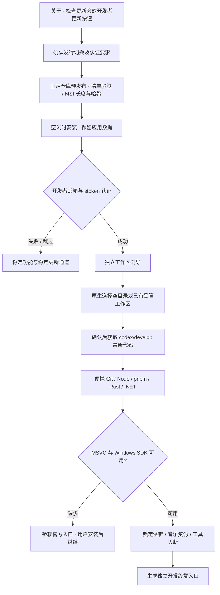

# 开发者更新与工作区准备

本分支新增两段独立流程：发布版选择官方开发者发行，以及开发者认证后的源码 / 环境准备。本轮未构建、安装或发布应用；远程分支和开发者安装包在维护者审核发布后才实际可用。



## 发行隔离

稳定客户端可以验证开发者清单，但只有明确选择发行切换后才接受开发者下载和安装租约。该选择不授予开发者身份。用户改写前端路由或更新状态不能绕过新客户端的 Rust 身份认证。

同一 X.Y.Z 的 `X.Y.Z-dev.N` 可作为发行切换目标，低于本机三段版本的包仍被拒绝。普通稳定检查不会自动选择 prerelease。不存在开发者发行时显示“尚未发布”，不下载其他产品或未签名文件；失败切换不让后续普通检查永久停留在开发者源。待安装指针记录用户切换意图以支持重启续传，安装前再次检查当前意图、签名和文件。

## 目录和开发环境

用户选择的是工作区根目录，内部布局为：

```text
所选工作区/
  source/                      codex/develop 工作副本
    .tools/                    Node、pnpm、Rust、.NET、C++ / SDK 私有副本
    .cache/                    依赖、编译及工具缓存
    .local/workspace-profile.json
  .zhenjing-setup/              便携 Git、下载缓存和有界任务日志
  .zhenjing-workspace.json      归属标记，不是身份凭据
  Open-DeveloperShell.cmd       用户自行打开的开发终端
  Start-DeveloperShell.ps1
```

至少需要 15 GiB 空间，建议为后续编译预留 30 GiB 以上。首次只接受空目录；再次准备只接受已登记工作区。既有源代码如含未提交改动、其他分支或不同 origin，停止并保留文件，不执行 reset / clean / 强推。更新仅采用 fast-forward，不自动处理冲突。

Git 使用官方 Git for Windows 的 MinGit ZIP；下载核对 GitHub 官方资产 SHA256，限制 HTTPS 重定向并检查 ZIP 路径和链接。关闭凭据助手、外部 hooks、递归子模块和符号链接检出。应用不上传代码或用户凭据。

确认准备时会执行固定仓库内的 bootstrap / prepare 脚本以及锁文件依赖安装。记录取得的 Git 提交以便核对；这不是对该提交的独立作者签名或安全审计。维护者应保护开发分支并审核依赖变动。

Node、pnpm、Rust 和 .NET 使用已有项目入口和官方校验元数据，安装到项目目录。C++ / SDK 从已有合法工具链只读发现、复制，不假定开发机的具体 VS 版本。缺失时明确等待用户通过微软官方入口安装，不运行系统安装器。已安装便携工具和源码保留，下次可继续准备。

开发终端还将 Git 配置隔离到 `source/.local/gitconfig`，不自动复制维护者或用户的全局作者信息、凭据。提交代码前可在该终端按需配置自己的作者和认证方式；这些本地设置不会进入仓库。

发布版工作区支持其他本地磁盘。仅当匹配工作区根与固定仓库配置时，开发入口才采用工作区模式；本机 `ZHENJING_RESTRICT_WRITES_TO_D=1` 始终优先，不能被工作区配置关闭。本轮不在 C 盘或其他盘符创建验证文件。

## 生命周期和恢复

- 准备在后台执行；界面轮询轻量状态，不阻塞窗口或创建多套任务。
- 可取消；仅终止本次启动的工具进程树，不按程序名清理其他用户进程。
- 退出应用、身份过期或原生准备超时后请求停止；保留源码、下载缓存和日志。网络读取使用超时，完成中断后可重试。
- 工具日志限额，源码拉取和各准备步骤有超时。失败不显示成功，不删除已有用户内容。
- 自动更新等待开发工作区任务完成，避免中途重启。
- 可以稍后设置，关于页面保留重新准备、更新源码及打开目录入口。目录被移动或删除后会重新提示，不信任失效的完成记录。

本地验证包括契约及 UI 流程测试、Rust 路径 / 更新规则测试，以及 `dev.ps1 test:developer:workspace`。后者仅使用 D 盘 Git 夹具，验证真实克隆、快进、未提交改动保护、Windows 参数、取消和 ZIP 越界；不联网克隆真实分支、不安装开发工具、不构建应用。
