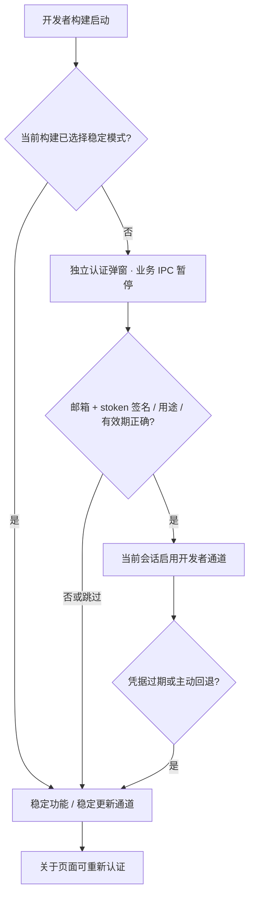

# 开发者版本与认证

## 发行约定

| 项目       | 发布版                           | 开发者版                               |
| ---------- | -------------------------------- | -------------------------------------- |
| 来源分支   | `main`                           | `codex/develop`                        |
| 标签       | `vX.Y.Z`                         | `vX.Y.Z-dev.N`，N 为 1..999999         |
| MSI        | `zhenjing-X.Y.Z-windows-x64.msi` | `zhenjing-X.Y.Z-dev.N-windows-x64.msi` |
| 签名清单   | `zhenjing-update.json`           | `zhenjing-developer-update.json`       |
| 分发目录   | `dist/desktop`                   | `dist/desktop-developer`               |
| Cargo 目录 | `.cache/cargo/target`            | `.cache/cargo/developer-target`        |
| GitHub     | 正式 Release，更新 `latest`      | prerelease，不更改 `latest`            |

两种发行沿用同一应用标识、MSI UpgradeCode、用户数据和更新验签密钥。MSI 的三段数字版本为 X.Y.Z，dev.N 由签名清单与原生编译信息描述。相同三段版本允许发行替换，较低三段版本仍禁止覆盖。两份 MSI 供选择，不能作为两个独立安装的应用同时使用。

开发者客户端从固定仓库最近 100 份 Release 中选取最高的规范开发者预发布版本；安装包始终来自不可混淆的固定标签 URL。若历史发布量超过此窗口，需归档过时预发布或扩展有界分页策略，不回退到任意 URL。

## 认证流程

发布版可在关于页的更新操作旁选择“更新到开发者版本”，通过签名更新链路安装预发布；认证仍发生在新客户端启动后。认证成功后的源码目录与环境向导详见 [开发者工作区与版本切换](开发者工作区与版本切换.md)。



认证由 Rust 完成。前端不能通过路由、设置文件或环境变量直接获得身份。认证前不启动托盘、热键、HUD 和自动更新业务；完成决定后由一次性原生启动器开启。辅助窗口不能管理开发者凭据。

stoken 由独立 Ed25519 私钥签发，payload 绑定规范化邮箱、专用 audience、随机 UUID、签发时间与过期时间。客户端只含公钥；变更任一受签字段会验签失败。默认有效期一年，认证状态只保留当前进程，不持久化 stoken；退出后新的开发者会话需重新认证。稳定模式只记住到当前开发者构建，升级后重新显示认证页。

用户已选择的回退语义是**稳定功能与稳定通道**。不执行 MSI 降级，不删除档案，也不宣称当前二进制已变成官方稳定发行的字节副本。切换时清除旧通道的待安装指针和租约；安装前再次核对通道，避免把开发者包装入稳定模式。

## 维护者凭据

`dev.ps1 developer:issue <邮箱>` 首次建立私钥和首批单邮箱签发配置，使用 D 盘忽略目录 `.local/developer-identity`。目录 ACL 仅允许当前 Windows 用户；私钥、首批邮箱与凭据不进入 Git 或安装资源。首次凭据已生成时拒绝意外覆盖。

- `issuer-private.pem`：签发私钥，需离线备份，不发送给开发者。
- `issuer.json`：当前批次允许的单个邮箱。
- `initial-credential.json`：邮箱、stoken 和有效期，仅安全交付给本人。
- `src-tauri/developer-channel.json`：可公开验签公钥，不包含邮箱或 stoken。

离线凭据不等于邮箱验证码，不验证邮箱所有权，也无法即时撤销。客户端不能保证绝对防破解；限制仅针对官方模式，不改变 AGPL 权利。完整边界见 [SECURITY.md](../../SECURITY.md)。

## 后续构建命令

从 0.10.3 起，用户已授权稳定版与开发者版平行构建。默认入口同时生成两份 MSI，输出目录和签名清单隔离，构建本身不自动上传或安装：

```powershell
# 默认成对构建稳定版和开发者版
powershell -NoProfile -ExecutionPolicy Bypass -File .\dev.ps1 desktop:build
# 只重试稳定版
powershell -NoProfile -ExecutionPolicy Bypass -File .\dev.ps1 desktop:build:stable
# 只构建开发者版，明确递增 dev 序号
powershell -NoProfile -ExecutionPolicy Bypass -File .\dev.ps1 desktop:build:developer -DeveloperBuild 1
# 同一源码顺序生成两份；不会互相清理分发目录
powershell -NoProfile -ExecutionPolicy Bypass -File .\dev.ps1 desktop:build:pair -DeveloperBuild 1
```

源码审核、提交、分支合并与标签准备完成后，在对应分支分别调用 `release:publish` / `release:publish:developer -DeveloperBuild N`。二者均先解包校验、创建草稿、上传六项资产并核对服务器摘要。再用 `release:verify` / `release:verify:developer` 检查公开下载和签名。发布前必须人工验收身份弹窗、失败回退、过期和通道更新；静态检查不替代首次真实打包验收。

成对构建供本地比较与验收；正式上传的每份包须在其对应分支提交完成后构建。合入 `main` 后重新构建稳定包，不能把其他提交的旧包冒充稳定发行。`build-info.json` 记录来源提交和工作区是否干净；上传脚本核对当前提交，并用该提交固定新标签目标。

升级基础版本时，先重建受版本约束的 Windows / 硬件 DLL 和来源清单并提交，再执行正式打包。构建期间若发现旧 DLL，入口会自动补建，但这类未提交产物只能用于本地检查；需提交后重新打包，不能绕过来源校验上传。
