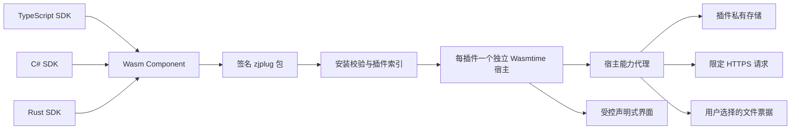

# 臻境插件系统

本系统允许使用 TypeScript、C# 和 Rust 编写插件。三个入口编译为相同的 WebAssembly Component，使用 `plugins/wit/plugin.wit` 定义的 ABI，由独立的 `zhenjing-plugin-host.exe` 执行。安装包中不运行 npm、Cargo、MSBuild、PowerShell 或安装脚本，不把第三方程序集或动态库加载到桌面主进程。

## 架构与边界



- Wasmtime 固定为 49.0.5，与本项目 Rust 1.96 工具链兼容。组件只接受 Wasm 源字节；不反序列化来自包的机器码缓存。
- WASI 不继承目录、环境变量、终端、TCP、UDP、DNS。插件无法直接调用 Tauri IPC、启动子进程、读取磁盘路径、载入 DLL、修改系统或打开任意 URL。
- 每个插件独立进程，最多同时启动 8 个。匿名管道中的身份来自宿主会话，不接受插件自己声明的身份。
- 每个宿主在接收组件字节之前加入 Windows Job 进程组，主程序异常退出也会由内核回收子进程。此保护不等同于原生代码沙箱，也不把线性内存预算宣称为整个进程的内存硬上限。
- 并发首次调用共享同一次宿主启动；正常取消不计为崩溃，启动 Future 意外取消后的遗留条目可自动恢复。安全模式下不会执行数据迁移代码。
- 组件线性内存总预算为 16–256 MiB，单值存储至多 1 MiB，私有数据至多 1–256 MiB；每次调用 100–30000 ms、10000–500000000 fuel。组件实例、表、内存数量以及随机字节请求也有限制。
- **线性内存预算不是 Windows 进程工作集硬上限。** 编译器、运行时元数据和语言运行库仍占宿主进程内存；编译启动另有 60 秒截止时间。Wasmtime 的 [ResourceLimiter 文档](https://docs.wasmtime.dev/api/wasmtime/runtime/limits/trait.ResourceLimiter.html) 说明了此边界。
- 单帧至多 2 MiB，每次调用至多 128 次能力请求；每插件每分钟最多 60 次调用、600 次能力请求、10 条通知。超过边界失败，不导出原始插件 stdout/stderr。
- 原生扩展与自定义 HTML/WebView 当前明确关闭。不能因为“单独进程”就把原生代码宣称为沙箱。插件中心会显示此状态。

## 用户操作

顶部拼图按钮打开插件中心，也可访问 `/plugins`。

1. 点击“安装本地插件”，在原生文件选择器中选择 `.zjplug`。
2. 核对名称、版本、发布者公钥、资源预算、权限理由和网络来源；可选权限默认不勾选。
3. 确认后安装，插件默认禁用；再次复核授权后启用。
4. 在详情查看资源配置与界面贡献。工具出现在工具页，小组件出现在首页，命令出现在搜索和插件详情。
5. 可停止宿主、撤销全部权限、停用、检查固定来源更新、回退上一版本或卸载。停止只结束当前实例，保留启用设置；下一次显式调用或定时任务可重新启动。要长期停止请停用。
6. 安全模式停止全部实例和后台任务，并在重启后持续生效，直到用户明确关闭。

签名只证明包的完整性和密钥一致，**不等同于平台审核或发布者可信**。首次安装需要核对公钥。插件 ID 与发布者密钥绑定，即使卸载仍保留绑定，防止同名插件接管旧数据。密钥轮换没有自动放行入口。

未签名包仅可在调试构建或认证开发者状态下显式选择；稳定版不接受。认证失效时再次调用也会拒绝未签名插件，不只检查安装时的状态。

## 包格式与校验

`.zjplug` 为 ZIP 数据包，至少包括：

```text
manifest.json        # UTF-8，最多 64 KiB
component.wasm       # WebAssembly Component，非 core-only Wasm / EXE / DLL
integrity.json       # 其他所有普通文件的 SHA-256
signature.json       # Ed25519 公钥和签名；仅本地开发模式可省略
LICENSE             # 作者应携带的授权文本
dependencies.json   # 作者维护的运行依赖和许可清单
```

安装包至多 64 MiB、256 个条目、解压总量 128 MiB。拒绝目录项、符号链接、Windows 重解析/设备路径、ADS、路径跳转、大小写重复文件与摘要表漏项。安装后保留原始签名包，每次启动重新校验包摘要、签名与索引中的清单。

签名消息为以下字节串，不对 JSON 再编码：

```text
UTF8("zhenjing-plugin-package-v1\0")
+ u64_le(manifest 原始字节数) + manifest 原始字节
+ u64_le(integrity 原始字节数) + integrity 原始字节
```

`signature.json` 的 `publicKey` 为 32 字节、`signature` 为 64 字节，均用小写十六进制。CLI 与 Rust 校验器使用相同定义。完整清单示例见 `plugins/examples/*/manifest.json`；未知字段会被拒绝。

## 能力 API

所有调用均通过 WIT 的 `capabilities.call`，请求为 `{"method":"…","params":…}`。结果是 JSON 文本，错误是受控字符串。SDK 不能缓存或扩大授权，宿主每次重新检查当前记录、包摘要、启用状态、声明和授权。

| 权限            | 方法                             | 输入与结果                                                    |
| --------------- | -------------------------------- | ------------------------------------------------------------- |
| `storage`       | `storage.get` / `put` / `delete` | `{key,value?}`；键限小写标识，插件私有 JSON                   |
| `settings`      | `settings.get`                   | API、宿主版本与平台；不返回应用配置和凭据                     |
| `network`       | `network.get`                    | `{url}`；UTF-8 文本，最多 1 MiB                               |
| `notifications` | `notifications.show`             | `{text}`；应用内通知，最多 512 字节                           |
| `hardware.read` | `hardware.read`                  | 已采集的利用率摘要；不自动启动采集、不含设备标识              |
| `games.read`    | `games.read`                     | Steam 游戏 appId、名称和安装状态；不含账号、路径              |
| `file.read`     | `file.read`                      | `{ticket}`；用户所选文件的 Base64，最多 512 KiB               |
| `file.write`    | `file.write`                     | `{ticket,base64}`；另存为新文件，最多 512 KiB，不覆盖已有文件 |
| `background`    | 清单中的 `tasks`                 | 60–86400 秒周期任务，宿主调度，不提供任意系统定时器           |

网络声明必须包含精确的 `https://域名` 来源，不支持通配符、凭据、非 443 端口或隐式内网访问。宿主解析并固定公网 IP、关闭系统代理、逐跳重新校验重定向，最多 3 次；拒绝本机、私网、链路本地、文档、映射和保留地址。插件更新仅从已安装清单的固定 `updateUrl` 下载，继续核对原 ID 和签名公钥，仍需用户复核权限。

文件权限不会直接授予目录。插件返回 `file` 节点，用户点击后，主界面打开可信原生选择器，得到 `{ticket,name,mode}`，再以 `{file:…}` 作为输入执行节点声明的命令。票据绑定插件和包摘要，5 分钟过期、仅用一次、停用/停止/升级时撤销，最多保留 32 个；不返回磁盘路径。宿主拒绝应用私有目录、安装组件、调试工作区。开发机写入继续受 D 盘保护约束。

## 声明式界面与生命周期

WIT 导出 `lifecycle.invoke(command, input)`，输入是 JSON 文本。`render` 和 `page/tool/widget` 贡献的命令返回视图 JSON；`command` 贡献和后台任务可返回业务 JSON。只有清单列出的命令可由用户调用，保留命令 `migrate/activate/deactivate` 不能作为普通贡献或任务。

界面支持 `stack/grid/heading/text/notice/metric/button/file`。字段限 `type/text/value/command/children/mode`，至多 200 个节点、8 层深度。按钮必须引用清单内的命令；`file` 另需 `mode: "read" | "write"`；只有 stack/grid 可有 children。文本通过 React 转义，永不接受 HTML、CSS、URL、脚本和任意事件函数。命令按钮不会随轮询、聚焦或导航重放。

```json
{
  "type": "stack",
  "children": [
    { "type": "heading", "text": "我的插件" },
    { "type": "metric", "text": "任务数", "value": "12" },
    { "type": "button", "text": "开始处理", "command": "process" },
    { "type": "file", "text": "选择文件", "mode": "read", "command": "import" }
  ]
}
```

组件实例按需创建并复用；停止、停用、撤权、升级、卸载、安全模式和主程序退出都会取消/终止对应实例。实例失败后可重建；连续三次失败隔离插件，重新授权启用可清除隔离。正常取消不计为崩溃。诊断只记录受控生命周期事件，不记录插件参数、响应、用户文件或原始进程输出。

## 更新、迁移与回退

- 更新要求 semver 更高、兼容当前 host/API、相同插件 ID 和发布者密钥；不自动沿用授权，安装后禁用。
- 数据版本 `dataVersion` 变化时，宿主复制私有数据，执行 `migrate`，输入 `{from,to}`，只允许操作该副本的 storage 能力。插件必须返回 `{"dataVersion":to}`。迁移失败丢弃副本，不切换索引。
- 成功后先写恢复日志，再更换数据目录，原子提交索引，最后整理上一版数据备份。启动恢复以磁盘索引为提交点，避免旧代码读取新格式数据。
- 回退同时恢复上一版签名包和该版本数据备份，重新撤权禁用；备份丢失时拒绝仅回退代码。通常只保留当前和上一版代码/备份；保留数据后重新安装的迁移前原数据，额外保留一份零摘要目录备份供人工恢复，防止清理代码时误删。
- 卸载先持久化禁用和撤权。默认保留私有数据及发布者绑定；明确勾选后删除私有数据与回退备份。清理失败保留禁用记录供重试。
- 损坏索引原样归档并进入安全模式；事务无法恢复时保留日志并阻止运行，不默默重置用户数据。

## 开发与构建

所有命令在项目根目录执行。工具、依赖、输出和缓存只写 D 盘，不需要全局安装或 PATH 修改。

```powershell
# 生成独立宿主（实际链接 EXE 并产生摘要，主程序下一次构建内嵌摘要）
powershell -NoProfile -ExecutionPolicy Bypass -File .\dev.ps1 plugins:host

# 创建工程；language 可为 typescript、csharp 或 rust
powershell -NoProfile -ExecutionPolicy Bypass -File .\dev.ps1 plugins:cli create --language typescript --id org.example.demo --out D:\插件开发\demo

# 检查清单、构建组件
powershell -NoProfile -ExecutionPolicy Bypass -File .\dev.ps1 plugins:cli check --project D:\插件开发\demo
powershell -NoProfile -ExecutionPolicy Bypass -File .\dev.ps1 plugins:cli build --project D:\插件开发\demo

# 密钥只保存在本工作区忽略的 .local 目录，不打印私钥
powershell -NoProfile -ExecutionPolicy Bypass -File .\dev.ps1 plugins:cli keygen --out D:\新境\.local\plugin-keys\demo
powershell -NoProfile -ExecutionPolicy Bypass -File .\dev.ps1 plugins:cli pack --project D:\插件开发\demo --key D:\新境\.local\plugin-keys\demo\publisher.pem
```

默认产物在 `.cache/plugins-build/<插件ID>/`。未签名开发打包需显式 `--unsigned true`。安装器从不调用这些构建命令；它们只用于开发者明确指定的源码项目。

TypeScript 使用严格 tsc 检查，再经 Vite 和 Jco 1.41.0 组件化；不提供 Node.js/fs/process 等宿主能力。Rust 使用 `wasm32-wasip2`、wit-bindgen 0.57.1 和 `Cargo.lock --locked`，开发机需先具备该 Rust target。C# 使用本地 .NET 10.0.403、Componentize SDK 0.8.0-preview00011、匹配的 LLVM NativeAOT 10.0.0-rc.1.26306.1、WASI SDK 29.0，开启锁定还原；不使用反射 JSON 序列化或 dynamic 绕过 ABI。

TypeScript 构建显式关闭引擎的 WASI HTTP 与 fetch-event 导入，网络必须通过 SDK 能力代理；不会为了兼容引擎默认配置而授予直接网络连接。

C# 官方工具链仍为预览发行，兼容性边界应随升级重新验证，参见 [上游发布记录](https://github.com/bytecodealliance/componentize-dotnet/releases)。本项目显式设置 `WASI_SDK_PATH` 到 `.tools/wasi-sdk/wasi-sdk-29.0`，缺失时拒绝构建，防止上游回退到 Windows 已知用户目录。CLI 可通过 `--dotnet`、`--wasi` 指定其他 D 盘工具路径。

三语言模板均提供计数器、受控界面和数据迁移示例。作者需要维护 `LICENSE` 与 `dependencies.json` 中实际嵌入依赖及许可；清单不自动等同于第三方依赖审计。

## 打包与维护

`scripts/package.ps1` 会先生成 Release 插件宿主，随后按既有稳定版/开发者版流程打包 MSI；插件宿主位于安装组件目录，主程序内嵌其 SHA-256 并在启动插件时校验、保持只读句柄。`verify-installer.ts` 同时核对插件宿主文件和清单。

独立宿主显式使用 Windows x64 target 与静态 CRT，同时覆盖 Rust 和 C/C++ 依赖；构建后检查实际 PE 导入表，拒绝依赖额外 VC++ DLL 的资源。构建标志仅在本次子进程范围生效并恢复，不修改全局 Cargo 配置。全新 CI 工作区先生成宿主与许可，再检查主程序。

桌面开发也使用独立 `plugin-runtime` 优化配置编译宿主，避免未优化的编译器在处理 C#/JavaScript 语言运行库时耗尽启动预算；桌面主程序仍按原调试配置运行。宿主通过固定的“编译/初始化”阶段帧定位耗时，阶段消息不会刷新 60 秒总期限。开发配置关闭 LTO 并限制构建并发为 2，以降低开发机内存峰值。

修改 WIT、SDK、运行时或构建工具后，应重新构建三种示例并运行 `test:plugins:host`、`test:plugins:native`、`test:plugins:workflow` 和 `plugins:check`，以及相关前端检查。`native/plugin-host` 是独立 Rust 工程，锁文件随源码提交；`check` 包含该宿主的格式、Clippy 和资源边界测试。完整管理流程测试使用 Tauri MockRuntime 提供界面句柄，但签名包、索引、数据事务和 Wasm 子进程走实际实现；默认标记 ignored，必须通过专用命令显式运行，避免普通单元测试依赖本机未生成的示例产物。运行时缺失、签名不符、未知权限、版本不兼容时明确失败，不回退到不受控原生执行。

发布构建只生成和核验 MSI，不执行真实安装；验收不进行系统设置、驱动、磁盘分区、账号或注册表修改。开发者版按独立预发布通道提供，不替换稳定版 latest。

Windows 原生库测试通过开发进程专用的 Cargo runner，为 D 盘生成的测试 EXE 嵌入 Common Controls v6 清单，以解析 Tauri/rfd 的 `TaskDialogIndirect`。仅使用已有 Windows SDK 的 `mt.exe`；缺失时给出微软官方入口，不自动安装。此操作不修改系统 DLL、注册表或全局 Cargo 配置，也不处理发布应用的可执行文件。

## 开发者内置插件：群会费智能表格

插件标识为 `org.zhenjing.builtin.group-dues`，入口位于插件中心。它是随应用审核、编译和分发的第一方模块，使用可信 React 表格与 Rust 账本服务；与外部 Wasm 包显式区分，不伪造签名、独立进程或沙箱说明，也不向第三方插件开放其专用接口。

仅当应用编译启用 `developer-edition` **且**当前开发者认证有效时，原生插件目录才返回此插件。所有读取、同步、头像和写入接口再次核验身份；普通稳定版、开发者版降权、过期凭据、调试模式和前端手写路由均不能取得其成员数据。安全模式禁止调用。前端按目录决定呈现，离开页面时清理包含个人资料的 Query 缓存。

### 成员同步和资料编辑

- 固定读取用户指定的群 API，不接受前端提供 URL、群号或文件路径。返回的 `group.wxid` 必须与固定群匹配，拒绝重复 wxid、数量矛盾、错误结构及超出容量的响应。
- API 四列分别映射为头像、群昵称、昵称、wxid。wxid 为只读唯一标识；群昵称、昵称和成员备注可本地编辑，也可选择恢复跟随 API。头像跟随 API。
- 再次同步保留本地覆盖字段、备注和全部缴费流水；完整名单中缺失的成员标记为非在群，不删除历史。不完整同步不会把遗漏成员当成退群；界面显示完整性及资料失败数量。
- 头像仅从已同步记录中的两个微信 HTTPS 来源下载，经过相同的公网 DNS/IP 及逐跳来源校验，限制四个并发、128 KiB 和 PNG/JPEG/WebP。前端只接受 data URL，失败时显示文字头像；CSP 无需放开外部网络。
- API 不提供历史入退群日期，人数和比率明确按**当前在群成员**统计；非在群成员及其历史流水仍可筛选查看。不能把当前名单宣称为某个历史月份的真实群成员名单。

### 会费、月份和统计口径

- 打开时自动选取本地当前月份，可切换任意支持月份或回到本月。未缴为默认状态，无需为每月复制一份成员表。
- 月费覆盖所选一个月；年费覆盖所选月份起连续十二个月，正确跨年。自定义金额覆盖所选一个月。固定月费和年费初始为 0，需用户自行设置；登记时也可调整单次金额。
- 金额以整数分持久化，前端用十进制字符串解析，不使用浮点乘法计算金额。单笔大于 0、最多 1,000,000 元、两位小数。设置变更不追溯改写原流水。
- 每位成员每个覆盖月份至多有一笔有效缴费。批量登记先核验全体成员及覆盖范围，任何一条冲突则整批不保存。确认窗展示成员、每人金额、合计、起止月份。
- 自动备注包含所选的年和月；年费注明连续十二个月。用户补充备注和成员备注独立保留，切换月份时展示对应缴费备注。
- 按月展示已缴人数、未缴人数、比率、起始月收款合计。年费在每个覆盖月计为已缴，但整笔金额仅在起始月计入收款合计，避免重复累计。筛选条件不改变顶部全体在群成员统计。
- 支持名称/wxid/备注搜索，缴费状态、成员范围、金额上下限筛选，以及未缴优先、姓名和金额排序。每页 25 条，可跨页选择并批量登记；改变筛选或月份会清空选择。
- 未缴使用暖色背景、左侧标记和“未缴”文字共同突出。深色主题调整状态文字颜色；窄窗口仅表格内部横向滚动。
- 已缴改回未缴通过“撤销缴费”完成，必须填写原因并复核覆盖月份。撤销年费影响整段十二个月；原金额、登记时间、撤销时间和原因保留，流水不直接删除。

### 数据保全与验收

账本保存在当前应用数据根的 `plugins/builtins/org.zhenjing.builtin.group-dues/ledger.json`，遵循现有数据目录与本机 D 盘限制。每次变更在独占 I/O 锁内读取最新 revision，拒绝过时窗口覆盖；验证完整账本后，先原子更新 `ledger.backup.json` 为上一次完整版本，再原子写入新账本。调用 Future 取消不会提前释放实际写入线程持有的锁。数据上限为 5,000 位成员、100,000 条流水及 16 MiB；损坏或重复覆盖的账本拒绝读取和覆盖，保留原文件及备份供人工恢复。此账本为本地管理记录，不自动上传缴费信息，也不自动向群成员发消息。

```powershell
# 仅此命令显式联网只读 API，断言原生网关与解析器兼容，不输出个人资料
powershell -NoProfile -ExecutionPolicy Bypass -File .\dev.ps1 test:plugins:dues-api

# 需本机已有 D 盘私有开发者凭据；真实验签与服务联调，使用独立临时账本
powershell -NoProfile -ExecutionPolicy Bypass -File .\dev.ps1 test:plugins:dues-native -DeveloperBuild 2

# 隔离浏览器合成数据验收；与真实认证/原生服务验收分开报告
powershell -NoProfile -ExecutionPolicy Bypass -File .\dev.ps1 test:plugins:dues-ui
```

三语言宿主、管理工作流、资源边界、账本原子事务和界面测试分别验证各自边界；不能用网页夹具代替开发者认证或实际原生运行证明。

会费原生联调显式编译开发者特性，先验证未认证不可见，再读取已有私有凭据并由正式验证器验签；覆盖同步、本地编辑、金额、年费冲突、撤销、重新打开持久化、安全模式及降权隐藏。测试只对临时账本登记缴费，不修改日常资料，也不向服务端写入会费。该测试默认忽略，不要求公共 CI 获得维护者凭据。

管理员高完整性级别的 WebView2 可能忽略环境提供的 CDP 调试参数。此环境下分别记录实际 Release EXE 启动结果、原生业务联调和隔离浏览器界面验收，不修改注册表或降低应用权限来制造调试成功。
